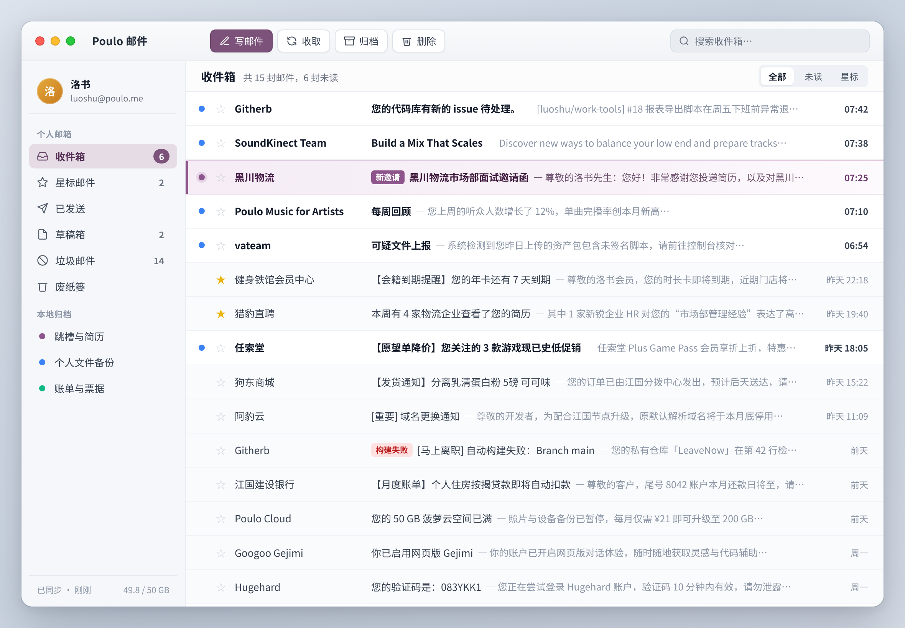

# 开局收件箱窗口截图草案（WIP）

- **状态：** 初版草稿（v2，待主创后续细调后定稿）
- **更新日期：** 2026-11-23
- **拟替换位置：** `Flow/Navigator.ink` 开局收件箱列表（第 421–447 行 `<h1>收件箱</h1>` 区块）
- **源文件与产物：**
  - 可编辑 HTML/CSS 模板：`Assets/opening_inbox.html`
  - 当前渲染稿（`2360 × 1640`，2x Retina PNG）：`Assets/opening_inbox_draft.png`



---

## 1. 当前版本设计说明

- **客户端外壳**：`Poulo 邮件`（对应世界观中的菠萝公司桌面端），浅色类 macOS 桌面风格。
- **账户与侧边栏细节**：
  - 账户名：`洛书` / `luoshu@poulo.me`
  - 统计对齐：收件箱共 `15` 封、未读 `6` 封、星标 `2` 封，与列表状态严格一致
  - 本地归档文件夹：`跳槽与简历`、`个人文件备份`、`账单与票据`
  - 左下角空间彩蛋：`49.8 / 50 GB`（呼应列表中 `Poulo Cloud` 的空间已满提醒）
- **视觉焦点**：第 3 封「黑川物流市场部面试邀请函」使用黑川紫（`#8d558b`）左侧高亮条、柔和淡紫底色及「新邀请」标签突出，保持未读且未加星标状态；摘要文字与 `Flow/Navigator.ink` 中 `= KKL_Letter` 正文开头完全一致。

---

## 2. 当前 15 封邮件语料明细

> 后续如需增删、改名、调整排序或修改摘要，直接对照下表提出微调意见，再改 `Assets/opening_inbox.html` 重新出图即可。

| # | 状态 | 发件人 | 主题 | 预览摘要 | 时间 | 来源 / 伏笔备注 |
| --- | --- | --- | --- | --- | --- | --- |
| 1 | 未读 | `Githerb` | 您的代码库有新的 issue 待处理。 | `[luoshu/work-tools] #18 报表导出脚本在周五下班前异常退出…` | `07:42` | 保留原开局语料 |
| 2 | 未读 | `SoundKinect Team` | Build a Mix That Scales | `Discover new ways to balance your low end and prepare tracks…` | `07:38` | 保留原开局语料 |
| 3 | **未读/高亮** | **`黑川物流`** | `[新邀请]` **黑川物流市场部面试邀请函** | `尊敬的洛书先生：您好！非常感谢您投递简历，以及对黑川物流的持续关注…` | `07:25` | 保留原开局语料；摘要对齐 `KKL_Letter` |
| 4 | 未读 | `Poulo Music for Artists` | 每周回顾 | `您上周的听众人数增长了 12%，单曲完播率创本月新高…` | `07:10` | 保留原开局语料 |
| 5 | 未读 | `vateam` | 可疑文件上报 | `系统检测到您昨日上传的资产包包含未签名脚本，请前往控制台核对…` | `06:54` | 保留原开局语料 |
| 6 | 已读/星标 | `健身铁馆会员中心` | 【会籍到期提醒】您的年卡还有 7 天到期 | `尊敬的洛书会员，您的时长卡即将到期，近期门店将有场地升级改造…` | `昨天 22:18` | 新增：对应 `健身铁馆` 设定与健身房路线 |
| 7 | 已读/星标 | `猎豹直聘` | 本周有 4 家物流企业查看了您的简历 | `其中 1 家新锐企业 HR 对您的“市场部管理经验”表达了高度兴趣…` | `昨天 19:40` | 新增（主创拍板保留“猎豹直聘”）：伏笔黑川物流 HR |
| 8 | 未读 | `任索堂` | 【愿望单降价】您关注的 3 款游戏现已史低促销 | `任索堂 Plus Game Pass 会员享折上折，特惠将于本周日 23:59 截止…` | `昨天 18:05` | 新增（主创拍板御三家三合一梗） |
| 9 | 已读 | `狗东商城` | 【发货通知】分离乳清蛋白粉 5磅 可可味 | `您的订单已由江国分拨中心发出，预计后天送达，请保持电话畅通…` | `昨天 15:22` | 新增（替换原电影票提案）：呼应巧克力奶 + 撸铁 + 收快递线 |
| 10 | 已读 | `阿豹云` | `[重要]` 域名更换通知 | `尊敬的开发者，为配合江国节点升级，原默认解析域名将于本月底停用…` | `昨天 11:09` | 保留原开局语料（补齐江国节点细节） |
| 11 | 已读 | `Githerb` | `[构建失败]` `[马上离职]` 自动构建失败：Branch main | `您的私有仓库「LeaveNow」在第 42 行检测到未闭合分支…` | `前天` | 由原重复的第 2 封 Githerb 改写为跳槽彩蛋 |
| 12 | 已读 | `江国建设银行` | 【月度账单】个人住房按揭贷款即将自动扣款 | `尊敬的客户，尾号 8042 账户本月还款日将至，请确认余额充足…` | `前天` | 新增（主创拍板改为“江国建设银行”）：现实生活压力 |
| 13 | 已读 | `Poulo Cloud` | 您的 50 GB 菠萝云空间已满 | `照片与设备备份已暂停，每月仅需 ¥21 即可升级至 200 GB…` | `前天` | 新增：菠萝生态经典空间已满梗 |
| 14 | 已读 | `Googoo Gejimi` | 你已启用网页版 Gejimi | `你的账户已开启网页版对话体验，随时随地获取灵感与代码辅助…` | `周一` | 保留原开局语料 |
| 15 | 已读 | `Hugehard` | 您的验证码是：083YKK1 | `您正在尝试登录 Hugehard 账户，验证码 10 分钟内有效，请勿泄露…` | `周一` | 保留原开局语料 |

> 已按主创反馈移除原提案中的「绒爪社区」私信及「电影院首映票」。

---

## 3. 重新出图方式

修改 `Assets/opening_inbox.html` 后，在仓库根目录执行以下命令即可无损重新生成 2x 高清截图：

```bash
/usr/bin/chromium --headless --disable-gpu --no-sandbox --hide-scrollbars \
  --window-size=1180,820 --force-device-scale-factor=2 \
  --screenshot="Ink Projects/即刻入职/__Docs/Assets/opening_inbox_draft.png" \
  "file://$(pwd)/Ink Projects/即刻入职/__Docs/Assets/opening_inbox.html"
```

---

## 4. 待定与后续待办

- [ ] 收集主创对当前草稿的细节微调意见（发件人、摘要、时间戳、标签、浅色/深色主题、窗口比例等）
- [ ] 定稿后确定最终图床外链或本地资源路径，并接入 `Flow/Navigator.ink`（使用 `# IMAGE:` 替换纯文字收件箱列表）
- [ ] 同步修正 `Flow/Navigator.ink` 开局附近发现的两处小笔误：
  - 第 417 行：`到了一杯牛奶` → `倒了一杯牛奶`
  - 第 473 行：`请假一请就S要请一天的` → `请假一请就是要请一天的`（或 `请假一请就要请一天的`）
