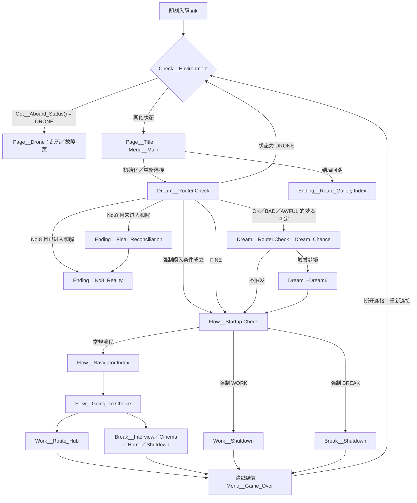

# 《即刻入职》故事线路图与状态说明

- 更新日期：2026-11-20
- 验证基线：`__Tests/` 13 项自动化回归全部通过（`inkjs@2.4.0`，47/47 `INCLUDE`，0 错误、0 警告），含种子 `1/7/42` 的纯点击九路线自然通关。Inky GUI 实机回归与宿主 `# RESTART` 尚未运行。

## 1. 主流程图



### 启动、梦境与强制闯入优先级

`Dream__Router.Check` 按以下顺序判定：

1. `DRONE` → 回到环境检查／故障乱码页。
2. `No.8` 且 `HAS_ENTERED_FINAL_RECONCILIATION == false` → 空白空间最终和解。
3. `No.8` 且该标记为 `true` → 现实苏醒的 No.8 结局。
4. `Get__Forced_Intrusion() != "NONE"` → 跳过随机梦境，进入 `Flow__Startup.Check` 触发强制 `WORK` 或 `BREAK`。
5. `FINE` → 不抽梦，直接进入正常启动。
6. 其他状态 → 按概率抽取梦境后进入正常启动。

## 2. 核心设计约束

- 故事发生在洛书已于现实中被 AZ 抓住之后；反复醒来发生在意识空间，且**直到大结局前洛书始终不认识 AZ**。
- 开局收到黑川物流市场部面试邀请函；首次导航只有面试与上班两个选择。
- 七条常规路线首次经历 `SAN_SCORE + 10`，重复经历 `+ 5`；两条 Shutdown 当前均不增加 `SAN_SCORE`（可避免玩家漏面试前提前误触 `BAD` 强制死局）。
- `FINE` 才出现健身；`OK` 与 `BAD` 都允许请假休息；未触发办公室终结（`Work__Shutdown`）前，即便进入 `BAD` 仍固定保留「上班｜去公司上班」。
- 精神状态恶化且前置路线缺失时触发 AZ 强制闯入，随后在 `DRONE` 状态下进入故障乱码页。
- 九条路线全部完成后，必须先进入空白空间最终和解，再进入现实 No.8 结局，中间及之后不再插入普通醒来或梦境。

## 3. 行动选择与路线

### 导航行动选择（`Flow__Going_To.Choice`）

入口 `SAN_SCORE = -1`，首次打开邀请函后增至 `0`（`FINE`）。当前选项可见条件：

| 选项 | 当前条件 | 行为 |
| --- | --- | --- |
| `请假｜去黑川物流面试` | `FINE` 或 `OK` | `-> Break__Interview` |
| `请假｜出门找人看电影玩` | `OK` 或 `BAD` | `-> Break__Cinema` |
| `请假｜呆在家里回血` | `OK` 或 `BAD` | `-> Break__Home` |
| 乱码 `向黑川物流效忠` | `AWFUL` | `-> Break__Shutdown` |
| `上班｜去公司上班` | `COUNT_ROUTE_WORK_SHUTDOWN == 0` | `-> Work__Route_Hub`（未触发上终前始终固定显示，含 `BAD`） |
| `[上班｜真的假的？]`（一次性 `*`） | `COUNT_ROUTE_WORK_SHUTDOWN != 0` 且非 `AWFUL` | 输出「天王老子来了今天也不想上班了。」后返回 `Choice` 并消失 |

### 工作路线（`Work__Route_Hub`）

- `Morning` 入口先检查四条常规上班路线（健身、下班、出差、小憩）是否全都不为 `0`；满足时直接触发 `Work__Shutdown`（办公室终结）。
- 否则上午提供出差选择（`Work__Business_Trip.Choice`）；下午按精神状态分流（`BAD` 直接进入 `Work__Napping.Flow`，`OK` 进入 `Work__Napping.Choice`，`FINE` 进入 `BuMi`）；晚上 `FINE` 可选健身或回家，其余状态可选回家。

### 请假路线

| 路线 | 含义 | 可见条件 |
| --- | --- | --- |
| `Break__Interview` | 黑川物流面试 | `FINE`／`OK` |
| `Break__Cinema` | 出门看电影 | `OK`／`BAD` |
| `Break__Home` | 在家休息／收快递 | `OK`／`BAD` |
| `Break__Shutdown` | AZ 强制闯入／居家终结 | `AWFUL` 乱码选项或启动强制分支 |

## 4. 精神状态与梦境概率

`Systems/Sanity.ink` 判定顺序（数值越高状态越差）：

| 状态 | 源码条件 |
| --- | --- |
| `AWFUL` | `score >= 60`，且健身、下班、出差、小憩、办公室、面试、电影、收快递 8 条路线均已记录 |
| `BAD` | `score >= 60`，但不满足 `AWFUL` 的 8 路线条件 |
| `OK` | `30 <= score < 60` |
| `FINE` | `score < 30` |

`Dream__Router.Check__Dream_Chance` 梦境概率：`FINE` 0%、`OK` 50%、`BAD` 75%、`AWFUL` 100%。随机池为 `Dream1`–`Dream6`（`Dream7` 已被 `INCLUDE` 但尚未加入随机池）。

## 5. 计数语义、身份状态与终局

### 变量与计数

- `SAN_SCORE`：初始 `-1` 为首次启动哨兵，首次打开邀请函后为 `0`。
- `COUNT_ROUTE_*`：各路线实际进入次数（`Business_Trip`／`Napping` 仅进入 `Flow` 时递增，预览取消不计数；菜单预览、结局回溯及 `Menu__Game_Over` 往返不计数）。
- `COUNT_GAME_OVER`：九条路线已完成结算的总次数，也是主菜单「重新连接：第 N 次」的序号。
- `COUNT_MENU_SEPARATOR`：主菜单分隔线点击次数；第 6 次会将九条路线计数置 `1` 并置 `UNLOCKED_NO8_DATABASE = true`（隐藏初始化／重新连接入口），不增加 `COUNT_GAME_OVER` 或 `SAN_SCORE`。

### 身份状态（`Systems/Aboard_Status.ink`）

1. 九条路线计数均不为 `0` → `No.8`。
2. 精神恶化且缺失前置关键路线、并已触发对应 Shutdown → `DRONE`。
3. 其他情况 → `Prototype`。

### 最终两阶段

```text
九条路线达成 No.8
  → Ending__Final_Reconciliation（空白空间和解；正文当前维护在 Obsidian「终局.md」）
  → Ending__No8_Reality（现实苏醒，成为黑川物流市场部部长 No.8）
```

`Ending__Final_Reconciliation` 入口置 `HAS_ENTERED_FINAL_RECONCILIATION = true`，并以 `PREVIOUS_WAKEUPS = COUNT_GAME_OVER - 1` 记录此前苏醒次数（9 轮自然通关时显示「前8次」）；第二次起直接跳过和解进入 `Ending__No8_Reality`。

## 6. 已知待修问题

- `Dreams/Router.ink` 以 `<- Dream4` 启动线程，Dream4 的点菜选项与行动菜单混排，点选后可能停在无选项状态。
- `UI/Pages/Logs.ink` 的返回调用不可达，2026／2025 日志页无法返回标题。
- `UI/Pages/Drone.ink` 的 `++ [确认重置]w` 会残留输出 `w` 再发出 `# RESTART`。
