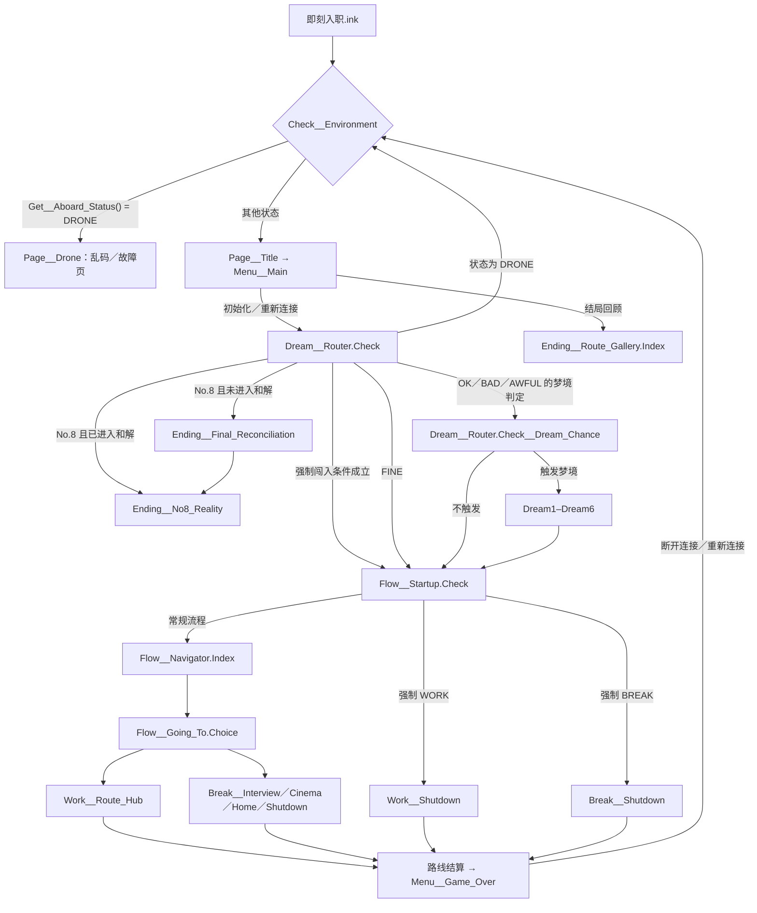

# 《即刻入职》故事线路图与状态说明

- 更新日期：2026-10-28
- 对应架构：目录迁移后的 `main`（PR #3）
- **验证声明：** 本文主要根据当前 Ink 源码静态整理，箭头不表示每条路径均已运行验证。Phase 0 的 InkJS 2.4.0 编译和 18 项 smoke 测试已通过；Phase 1 另在 `__Tests/` 建立 11 项可复用回归并全部通过（含直接路径与状态注入）。历史上两款 inklecate 交叉编译、29 项 smoke 与纯点击九路线完整自然通关也已通过，但 29 项 smoke 的执行脚本 `tools/phase0_smoke.cjs` 已按主创要求删除，**该 29 项与自然通关当前不可复跑**；当前 11 项回归不覆盖自然通关。Inky GUI 实机回归、宿主 `#RESTART` 与作者验收仍未运行。验证记录见 [PHASE0_VALIDATION.md](PHASE0_VALIDATION.md)。

## 1. 主流程图



### 启动、梦境和强制闯入的优先级

`Dream__Router.Check` 当前按以下顺序判断：

1. DRONE → 回到环境检查／异常页。
2. No.8 且 `HAS_ENTERED_FINAL_RECONCILIATION == false` → 空白空间最终和解。
3. No.8 且该标记为 true → 现实苏醒的 No.8 结局。
4. `Get__Forced_Intrusion() != "NONE"` → 进入启动分流，由 `Flow__Startup.Check` 决定强制 WORK 或 BREAK。
5. FINE → 直接进入正常启动流程。
6. 其他精神状态 → 按梦境概率决定是否进入随机梦境，再进入正常启动流程。

这意味着 No.8 与强制闯入检查优先于普通随机梦境。需要通过实机测试确认每个状态组合的实际可达性。

## 2. 作者确认的故事设计约束

以下是主创明确的叙事目标，不应仅因为当前代码与之不一致就反过来修改设定：

- 故事发生在洛书已于现实中被 AZ 抓住之后。反复醒来首先发生在精神空间。
- 开局收到黑川物流市场部面试邀请函；首次导航仅有面试与上班两个选择。
- 第一次经历某条普通路线增加精神数值 10，重复经历增加 5；反复刷同一条路线不应成为最佳策略。
- FINE 时才考虑健身；BAD 时更想休息；OK 与 BAD 都允许考虑休息。
- 精神状态恶化且部分路线尚未经历时，下一次醒来可能触发 AZ 强制闯入；其后在 DRONE 状态下显示故障乱码。
- 所有普通路线的结局都是被入职。若所有路线完成且洛书仍保有自我，必须在空白空间中完成与自己的和解；这是最后一次精神空间的醒来。随后才在现实中醒来，接受 AZ 的安排，成为黑川物流市场部部长 No.8。
- 空白空间是最终和解，不是普通路线回顾项，也不能在其后再插入一次普通梦境／精神空间醒来。

## 3. 行动选择与路线

### 初始行动

入口 `SAN_SCORE = -1`，`Get__Sanity_State(-1)` 应返回 FINE。当前 `Flow__Going_To.Choice` 的条件设计为：

| 选项 | 当前条件 |
| --- | --- |
| 请假去黑川物流面试 | FINE 或 OK |
| 请假出门看电影 | OK 或 BAD |
| 请假在家休息／收快递 | OK 或 BAD |
| 异常乱码的居家终结选项 | AWFUL |
| 去公司上班 | 非 BAD／AWFUL，或办公室终结尚未经历 |

因此首次 FINE 导航应只显示面试和上班。请用实际运行验证，而不要只依据静态条件判断。

### 工作路线

- `Work__Route_Hub.Morning` 先检查部分已经历路线；若健身、下班、出差、小憩均有记录，会转入办公室终结。
- 上午可能进入出差路线；下午根据精神状态处理小憩；晚上 FINE 状态才显示健身选项，另可选择下班回家。
- BAD 状态的下午逻辑当前会直接转入小憩流程；OK 状态进入小憩选择；FINE 状态跳过小憩分支。
- 具体分支还受已经历路线和前置条件影响，不能把上述概括当作每次都出现的固定菜单。

### 请假路线

| 路线 | 目标含义 | 当前可见入口条件 |
| --- | --- | --- |
| `Break__Interview` | 黑川物流面试 | FINE／OK |
| `Break__Cinema` | 出门看电影 | OK／BAD |
| `Break__Home` | 在家休息／收快递 | OK／BAD |
| `Break__Shutdown` | AZ 强制闯入／居家终结 | AWFUL 的特殊选项或启动强制分支 |

## 4. 精神状态与梦境概率

`Systems/Sanity.ink` 的当前判定顺序：

| 状态 | 源码条件 |
| --- | --- |
| AWFUL | `score >= 60`，且健身、下班、出差、小憩、办公室、面试、电影、收快递这 8 条普通路线都有记录 |
| BAD | `score >= 60`，但不满足 AWFUL 的路线集合条件 |
| OK | `30 <= score < 60` |
| FINE | `score < 30` |

`Dream__Router.Check__Dream_Chance` 当前梦境概率：

| 状态 | 概率／行为 |
| --- | --- |
| FINE | 不抽梦，直接正常启动 |
| OK | 50% |
| BAD | 75% |
| AWFUL | 100% |

随机池目前只有 Dream1–Dream6。Dream7 虽在入口文件中被 INCLUDE，但未在 `Dream__Router.Shuffle` 中调用；是否加入随机池是待主创确认的设计决定。

## 5. 身份状态、路线计数和终局

### 路线计数

- `SAN_SCORE`：初始 `-1` 是首次启动哨兵，首次打开邀请函后为 `0`；数值越高状态越差。七条非 Shutdown 路线首次 +10、重复 +5；两条 Shutdown 当前不增加 SAN，设计仍待主创确认。
- `COUNT_ROUTE_WORK_*`、`COUNT_ROUTE_BREAK_*`：每条路线的实际进入次数；0 表示未经历，非 0 表示已经历。`Business_Trip`／`Napping` 只在进入 `Flow` 时计数，预览／取消不计；其余在路线 Knot 入口计数。菜单预览、结局回顾、`Menu__Game_Over` 与标题往返均不增加。
- `COUNT_GAME_OVER`：九条路线已完成结算的全局总次数，也是「重新连接：第 N 次」的序号；不是唯一路线数。每条路线每次结算恰好 +1。
- `COUNT_MENU_SEPARATOR`：主菜单分隔线点击次数；前 5 次只增加它。第 6 次会把九条路线计数置 1 并解锁 No.8 数据库入口，但不增加 `COUNT_GAME_OVER` 或 SAN。

### 身份状态

`Systems/Aboard_Status.ink` 当前优先检查：

1. 5 条 Work 路线与 4 条 Break 路线全部有记录 → `No.8`。
2. 部分 BAD／非 FINE 状态、路线缺失且相应 Shutdown 已发生 → `DRONE`。
3. 其他状态 → `Prototype`。

隐藏菜单第 6 次点击分隔线会把九条路线计数直接设为 1，并置 `UNLOCKED_NO8_DATABASE = true`；它不会增加 `COUNT_GAME_OVER` 或 `SAN_SCORE`，但会让“计数满足 No.8 门槛”不再意味着玩家自然经历过每条路线。`UNLOCKED_NO8_DATABASE` 的实际用途是隐藏主菜单的初始化／重新连接入口。测试时应把正常通关与隐藏菜单捷径分开，也不要误写成“隐藏入口完全不写路线计数”。

### 最终两阶段

```text
所有路线达到 No.8 判定
  → Ending__Final_Reconciliation
  → 在空白精神空间中醒来并与自己和解
  → Ending__No8_Reality
  → 现实中醒来，接受 AZ 的安排，成为市场部部长 No.8
```

当前 `Ending__Final_Reconciliation.ink` 在场景开始时设置 `HAS_ENTERED_FINAL_RECONCILIATION = true`，并用 `COUNT_GAME_OVER - 1` 生成前几次醒来的数量。状态注入测试与历史完整自然通关均已确认 `COUNT_GAME_OVER = 9` 时显示“前8次”，终局顺序正确（自然通关为历史记录，执行脚本已删除、当前不可复跑）；最终醒来次数的叙事含义仍按 Phase 3 待核对。现实结局文件目前仍有 TODO 和 AI 草稿，需要主创审阅。

## 6. 当前需验证的问题

- [x] InkJS 2.4.0 编译、所有 INCLUDE 与 Divert 目标；两款 inklecate 交叉编译也已通过。
- [x] 初始导航确实只有面试／上班。
- [x] 普通路线首次 +10、重复 +5，九条路线的 `COUNT_GAME_OVER` 每次只增加一次。
- [x] OK／BAD 休息选项和 FINE 健身条件。
- [x] 已测强制闯入路径在下一次环境检查进入 DRONE 乱码页。
- [x] 全路线自然经历时 No.8 门槛正确；隐藏菜单捷径的计数写入也已单独验证。
- [x] 状态注入与历史完整自然通关中“空白空间 → 现实 No.8”顺序均正确，不出现额外普通醒来。
- [x] 结局回顾、菜单预览与 `Menu__Game_Over`／标题往返不意外改变路线计数或精神状态。
- [x] Gym 的历史次数使用 `Work__Gym.Game_Over` Stitch 读计数，首次／重复显示至少 1／2 次，不混淆 `COUNT_GAME_OVER`。
- [ ] 两条 Shutdown 的 SAN 增加与否仍待主创确认（现状均不增加）。
- [ ] 主菜单中的 `【DEV】` 调试信息当前由块注释隐藏，是否保留由主创决定。
- [ ] Inky GUI 实机回归、宿主 `#RESTART` 与作者验收尚未进行。

**复跑边界：** 当前唯一可复跑的自动化测试是 `__Tests/` 的 11 项（`inkjs@2.4.0`）。29 项 smoke 与纯点击自然通关是历史结果，执行脚本已删除，**当前不可复跑**；需要重新自动验证自然通关时，应在 `__Tests/` 新增纯点选驱动，而不是恢复 `tools/phase0_smoke.cjs`。inklecate 交叉编译不受此限制：可按 [PHASE0_VALIDATION.md](PHASE0_VALIDATION.md) 第 1 节的历史编译方式对当前源码重新编译，但历史产物哈希只对同一基线快照有效，且重编译不替代 Inky GUI 实机回归与作者验收。

本图用于沟通和审查；任何实现变更后都要同步更新。若故事设定与代码不一致，应在文档中标出差异并交给主创决定，不要由实现者自行推断。
