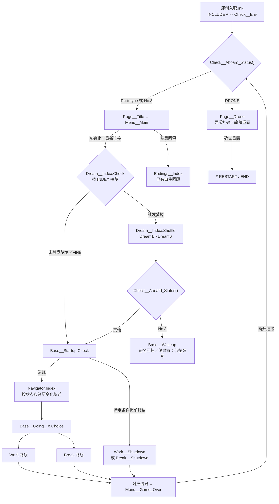
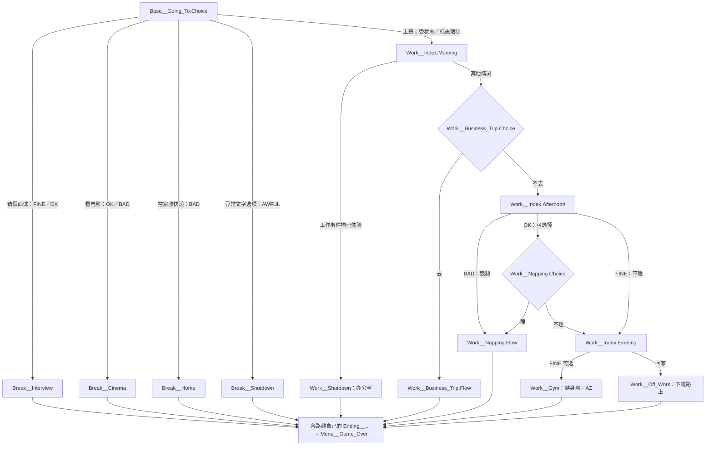

# 《即刻入职》故事线路图（当前实现）

> 根据 main commit b6edda0a51aa253f2f256d978ba482f7c2cc2e2c 中的 Ink 源码静态整理。**实线表示当前可见的 divert／分支关系，不保证经实机测试可达；图中简化了对白、循环条件与局部 Stitch。** 设定解释与代码事实分列说明。

## 一、入口、重新连接和深层故事

**叙事层面的理解：** 洛书在工作／请假选择中反复遇到 AZ 所代表的“入职”事件；不同遭遇累计成跨周目的记录与压力变化。随着循环，梦境逐渐透露黑胶同化、意识和身份的信息。Base__Wakeup 进一步提出反复死亡／重新连接以及 No.8 身份问题。它目前仍有占位与未完段落，不把未写出的真相当成已实现剧情。

## 二、工作与请假路线（事件级）

上图按已写出的显式入口组织，**不是保证每条路径同时可选**：

- Base__Startup.Check 在常规导航前可能强制 Work__Shutdown 或 Break__Shutdown，因此不能只看 Base__Going_To 的选项判断可达性。
- Work__Index.Morning 在四个工作事件（Gym、Off_Work、Business_Trip、Napping）均已有记录时自动进入办公室终结。
- Work__Index.Afternoon 的 BAD 状态直接转入小憩，而 FINE 状态跳过小憩；晚间健身选项还依赖 FINE。
- Break__Index 文件有“Interview／Cinema／Home 都有记录时转居家终结”的判定，但当前主行动菜单由 Base__Going_To.Choice 直接跳转各 Break 事件；这段判定是否实际被调用仍待核查。

## 三、结局事件与数值变化

Flag__... 虽名为 Flag，当前由 ++ 更新，实际表示**事件经历次数**，判断 != 0 表示已看过。下表仅说明对应事件文件中可见的直接更新。

| 事件 | 对应计数 | 首次／重复对 INDEX 的变化 | 增加 Count__Game_Over |
| --- | --- | --- | --- |
| 工作：出差 | Flag__Work__Business_Trip | +10／+5 | 是 |
| 工作：健身房 | Flag__Work__Gym | +10／+5 | 是 |
| 工作：下班路上 | Flag__Work__Off_Work | +10／+5 | 是 |
| 工作：小憩 | Flag__Work__Napping | +10／+5 | **未看到（待确认）** |
| 工作：办公室 | Flag__Work__Shutdown | 未直接增加 | 是 |
| 请假：面试 | Flag__Break__Interview | +10／+5 | 是 |
| 请假：电影院 | Flag__Break__Cinema | +10／+5 | 是 |
| 请假：收快递 | Flag__Break__Home | +10／+5 | 是 |
| 请假：居家终结 | Flag__Break__Shutdown | 未直接增加 | 是 |

INDEX 初始化为 -1，Base/Navigator.ink 的初次面试信分支将其增加为 0。是否最终应将它定义为“压力”还是“sanity”需要主创确定：**现有规则是值越大，状态越差**。

## 四、精神状态、梦境、终局和异常

### 精神状态（Functions/Check__SAN.ink）

| 返回值 | 当前代码条件（按判定顺序） | 梦境抽取概率（Dream__Index.Check） |
| --- | --- | --- |
| AWFUL | INDEX >= 60，且已出现 5 个 Work + 3 个 Break 事件记录（不含 Break__Shutdown） | 100% |
| BAD | 不满足上项且 INDEX >= 60 | 75% |
| OK | 30 <= INDEX < 60 | 50% |
| FINE | INDEX < 30 | 0% |

### No.8 身份判定（Functions/Check__Aboard_Status.ink）

- 优先条件：**5 个 Work + 4 个 Break** 事件全部已有记录，返回 "No.8"（和 AWFUL 的条件**不相同**）。
- 其次根据状态、未完成事件与相应 Shutdown 事件，返回 "DRONE"；环境检查将其导向异常乱码页，页面提供重置。
- 其他情况返回 "Prototype"，走正常标题界面。
- Dream__Index.Shuffle 完成后再次检查 "No.8"；成立才进入 Base__Wakeup。这不是普通结局回顾。

### 随机梦境池

Dream__Index.Shuffle 当前写了 Dream1～Dream6 六个调用。**Dreams/Dream7.ink 已 INCLUDE、已有内容，但尚未出现在 Shuffle 列表中。** 不应在资料图上误画成随机可抽到。

### 菜单隐蔽入口

Menu__Main 的分隔线选项累计点击超过 5 次时，会把多个 Flag 设置为 1，并开放 No.8／结局回溯相关文本。这是当前源码提供的特殊入口；不视为正常流程里自然达成全部事件的证明。

## 五、维护时如何更新本图？

1. 新增可选事件：在第二张图加入节点和跳转；同步更新结局表。
2. 修改 INDEX、事件门槛、梦境概率：同步修改第四节的条件表，并检查 Check__SAN 与 Check__Aboard_Status 的先后次序。
3. 添加真结局文本：单独扩展 Base__Wakeup 的局部流程，避免主图过密。
4. 发布前对至少 FINE、OK、BAD、AWFUL 与特殊 No.8／DRONE 路径进行实际 Ink 编译和游玩测试；静态结构图无法替代测试。
