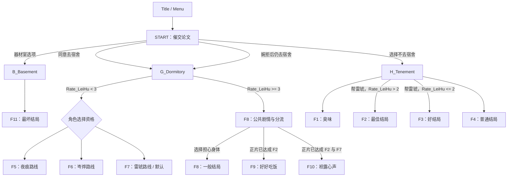

# 故事线与结局目录

> 依据源码静态整理，并结合作者已确认的设计意图。结局达成标记与预览隔离已写入源码，但尚未运行 Ink 编译或完整交互测试；宿舍线 A-01 的条件重写仍待实施。

## 1. 文件职责

入口文件 [`圣诞大攻略：雷琥.ink`](../圣诞大攻略：雷琥.ink) 按顺序 INCLUDE：

| 文件 | 职责 |
|---|---|
| [`0_Main.ink`](../0_Main.ink) | 标题、开始入口、初始对话与主要场景选择 |
| [`B_Basement.ink`](../B_Basement.ink) | 器材室入口；目前直接跳转到 F11 |
| [`G_Dormitory.ink`](../G_Dormitory.ink) | 宿舍日常、夜痕/岑烨/雷琥选择计数、宿舍线结局判定 |
| [`H_Tenement.ink`](../H_Tenement.ink) | 出租屋日常、空调与饮食选择、雷琥好感度及 F1–F4 分流 |
| [`Z_VAR.ink`](../Z_VAR.ink) | 变量声明、周目重置、结局统计、结局回顾与开发者菜单 |
| [`Z_Finale.ink`](../Z_Finale.ink) | F1–F11 的结局正文，以及 F8 到 F9/F10 的隐藏分支 |
| [`Z_End.ink`](../Z_End.ink) | 统一的结局后界面和返回标题入口 |
| [`Z_Misc.ink`](../Z_Misc.ink) | 更多信息、结局回顾和返回标题 |

## 2. 主线结构

宿舍线的作者意图是“选择过对应角色即可作为路线资格”，不是比较谁的倾向计数最高。重构计划建议将条件改成明确的 `Choose_X > 0`，并把多个角色都被选择时的优先级显式化；参见 [重构方案](REFACTOR_PLAN.md)。

## 3. 主要状态变量

当前变量定义见 [`Z_VAR.ink`](../Z_VAR.ink)。

| 变量 | 用途 | 当前/计划 |
|---|---|---|
| `Rate_LeiHu` | 雷琥好感度/亲近程度 | 当前周目变量，由 `CleanData` 重置 |
| `Choose_YeHen` | 夜痕选择计数 | 当前周目变量，由 `CleanData` 重置 |
| `Choose_CenYe` | 岑烨选择计数 | 当前周目变量，由 `CleanData` 重置 |
| `Choose_LeiHu` | 雷琥选择计数 | 当前周目变量，由 `CleanData` 重置 |
| `FinaleCount` | 正式达成的不同结局数量 | 已改为统计正式达成标记，尚待运行时验证 |
| `Ending_F1_Achieved`–`Ending_F11_Achieved` | 正片实际达成的不同结局 | 已新增；普通新周目保留，结局回顾/开发者预览不设置 |
| `IsPreviewMode` | 是否处于结局回顾或开发者预览模式 | 已新增；用于防止预览影响正式结局记录 |

当前 `CleanData` 会将好感度与三个人物选择计数重置为 0，并清除临时预览模式；它不会重置正式结局达成标记。`CountFinale` 已改为统计这些达成标记。RESTART 的全量重置行为仍需在实际宿主环境中验证。

## 4. F1–F11 目录

| Knot | 回顾菜单标题 | 主要入口/条件 | 维护备注 |
|---|---|---|---|
| `Finale.F1` | 普通结局《臭味》 | 出租屋线选择嗅闻衣物 | 正片完成时记录达成 |
| `Finale.F2` | 最佳结局《为什么告诉我这些》 | 出租屋线选择帮助雷琥，且 `Rate_LeiHu > 2` | 计划作为 F9/F10 的正片解锁条件 |
| `Finale.F3` | 好结局《我知道了》 | 帮助雷琥，但 `Rate_LeiHu <= 2` | 正片完成时记录达成 |
| `Finale.F4` | 普通结局《唉……体育生》 | 出租屋线选择让雷琥自己处理 | 正片完成时记录达成 |
| `Finale.F5` | 普通结局《服从》 | 宿舍线低好感分支；选择过夜痕即可具备路线资格 | 重复选项是有意叙事设计，保留 |
| `Finale.F6` | 普通结局《求主人……》 | 宿舍线低好感分支；选择过岑烨即可具备路线资格 | 汇合选项是有意叙事设计，保留 |
| `Finale.F7` | 坏结局《失踪》 | 宿舍线低好感分支；选择过雷琥或走默认路线 | 多角色同时被选时的优先级需明确 |
| `Finale.F8` | 一般结局《担心身体》 | 宿舍线 `Rate_LeiHu >= 3`；同时承载公共剧情与分流 | 仅选择并完成此结局时才记录 F8 |
| `Finale.F9` | 好结局《好好吃饭》 | F8 中正片已达成 F2 后可进入 | 计划使用正式达成标记解锁 |
| `Finale.F10` | 真正结局《袒露心声》 | F8 中正片已达成 F2 与 F7 后可进入 | 计划使用正式达成标记解锁 |
| `Finale.F11` | 最坏结局《圣诞快乐》 | `B_Basement` 直接跳转 | 正片完成时记录达成 |

## 5. 多周目、回顾与开发者菜单

- **正式结局回顾**：源码已改为只列出通过正片实际达成的结局，而不是仅仅访问过对应 Knot；待运行时验证。
- **开发者菜单**：源码中保留了通过多次点击解锁的开发者入口，以及 `All_Finale` 直接预览全部结局的菜单。预览入口已设置 `IsPreviewMode`，不应写入正式结局达成标记；待运行时验证。
- **F8**：是公共剧情与分流节点；源码已改为只有选择“担心身体”并走完该结局才算 F8 达成。进入 F9/F10 不会记录 F8；待测试。
- **F9/F10**：源码已从 Knot 访问条件改为正式达成条件，避免开发者预览 F2/F7 影响正片隐藏路线；待测试。
- **普通新周目**：重置当前周目的好感度与角色选择计数，但保留正式结局达成记录。
- **RESTART**：当前作品明确提示它会清除数据；具体持久化行为需在项目宿主中验证。

实施步骤与验收标准见 [重构方案](REFACTOR_PLAN.md)；当前源码尚未应用这些修改。
