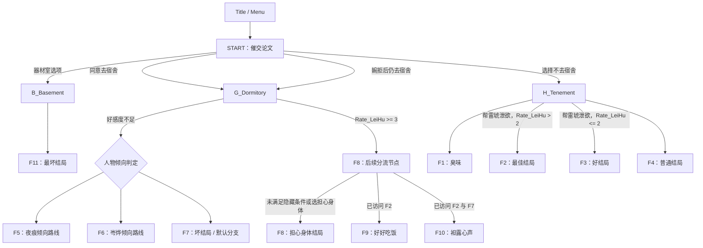

# 故事线与结局目录

> 依据源码静态整理。这里记录的是当前脚本的实际连接方式与可见设计意图；宿舍线的数值比较存在待修复问题，不能将其视为已经验证的正确分流。

## 1. 文件职责

入口文件 [`圣诞大攻略：雷琥.ink`](../圣诞大攻略：雷琥.ink) 按顺序 INCLUDE：

| 文件 | 职责 |
|---|---|
| [`0_Main.ink`](../0_Main.ink) | 标题、开始入口、初始对话与主要场景选择 |
| [`B_Basement.ink`](../B_Basement.ink) | 器材室入口；目前直接跳转到 F11 |
| [`G_Dormitory.ink`](../G_Dormitory.ink) | 宿舍日常、夜痕/岑烨/雷琥倾向计数、宿舍线结局判定 |
| [`H_Tenement.ink`](../H_Tenement.ink) | 出租屋日常、空调与饮食选择、雷琥好感度及 F1–F4 分流 |
| [`Z_VAR.ink`](../Z_VAR.ink) | 变量声明、重置、结局计数、结局回顾与开发解锁菜单 |
| [`Z_Finale.ink`](../Z_Finale.ink) | F1–F11 的结局正文，以及 F8 到 F9/F10 的隐藏分支 |
| [`Z_End.ink`](../Z_End.ink) | 统一的结局后界面与返回标题入口 |
| [`Z_Misc.ink`](../Z_Misc.ink) | 更多信息、结局回顾和返回标题 |

## 2. 主线结构

图中的 F5/F6/F7 路由是根据当前源码条件和注释意图概括的。当前条件把数值与逻辑 `or` 混合使用，实际结果需先修正并测试，详见 [逻辑审查记录](LOGIC_AUDIT.md)。

## 3. 主要状态变量

变量定义见 [`Z_VAR.ink`](../Z_VAR.ink)。

| 变量 | 用途 | 当前主要变化位置 |
|---|---|---|
| `Rate_LeiHu` | 雷琥好感度/亲近程度 | `G_Dormitory.ink`、`H_Tenement.ink` |
| `Choose_YeHen` | 夜痕倾向计数 | `G_Dormitory.ink` |
| `Choose_CenYe` | 岑烨倾向计数 | `G_Dormitory.ink` |
| `Choose_LeiHu` | 雷琥倾向计数 | `G_Dormitory.ink` |
| `FinaleCount` | 本次统计时发现的已访问结局 Knot 数量 | `Z_VAR.ink` 的 `CountFinale` |
| `START` | Ink 访问计数，用于显示攻略周目相关提示 | 主入口 Knot |

`CleanData` 会将好感度与三个人物倾向重置为 0；它没有显式重置 Knot 的访问历史。这与 F9/F10 的跨周目解锁设计有关。不要在未理解访问计数机制前，将这些条件简单改成普通变量判断。

## 4. F1–F11 目录

| Knot | 菜单标题 | 主要入口/条件 | 维护备注 |
|---|---|---|---|
| `Finale.F1` | 普通结局《臭味》 | 出租屋线选择嗅闻衣物 | 单独结局 |
| `Finale.F2` | 最佳结局《为什么告诉我这些》 | 出租屋线选择帮助雷琥，且 `Rate_LeiHu > 2` | 同时是 F9/F10 的历史解锁条件 |
| `Finale.F3` | 好结局《我知道了》 | 帮助雷琥，但 `Rate_LeiHu <= 2` | 单独结局 |
| `Finale.F4` | 普通结局《唉……体育生》 | 出租屋线选择让雷琥自己处理 | 单独结局 |
| `Finale.F5` | 普通结局《服从》 | 宿舍线低好感分支；意图上关联夜痕倾向 | 倾向判定表达式需修复/验证 |
| `Finale.F6` | 普通结局《求主人……》 | 宿舍线低好感分支；意图上关联岑烨倾向 | 倾向判定表达式需修复/验证 |
| `Finale.F7` | 坏结局《失踪》 | 宿舍线低好感默认分支/雷琥倾向分支 | 倾向判定表达式需修复/验证；也是 F10 的历史条件 |
| `Finale.F8` | 菜单称《担心身体》 | 宿舍线 `Rate_LeiHu >= 3`；也承载隐藏分流 | 当前同时充当结局与网关，导致结局统计歧义 |
| `Finale.F9` | 好结局《好好吃饭》 | F8 中 `Finale.F2` 已访问 | 需要先达成/访问 F2 |
| `Finale.F10` | 真正结局《袒露心声》 | F8 中 `Finale.F2 && Finale.F7` 均满足 | 需要先访问 F2 与 F7 |
| `Finale.F11` | 最坏结局《圣诞快乐》 | `B_Basement` 直接跳转 | 当前器材室入口没有其他逻辑 |

## 5. 多周目与结局回顾

- F8 中的 F9 选项条件为 `Finale.F2`；F10 选项条件为 `Finale.F2 && Finale.F7`，位置在 [`Z_Finale.ink`](../Z_Finale.ink) 第 155–159 行。
- `FinaleList` 使用各个结局 Knot 的访问状态控制回顾菜单；`All_Finale` 则提供直接查看全部结局的入口，位置在 [`Z_VAR.ink`](../Z_VAR.ink) 第 82–150 行附近。
- 由于结局统计也使用 Knot 访问状态，任何兼作中间分流节点的 Knot 都不应自动等同于“已达成结局”。当前 F8 正是需要拆分这两个概念的例子。
- 作品标题提示尽量不要按 RESTART，说明作者有意保留跨周目的访问历史。修改前应先在实际 Ink 运行环境验证保存、重开、返回标题和 RESTART 的区别。
