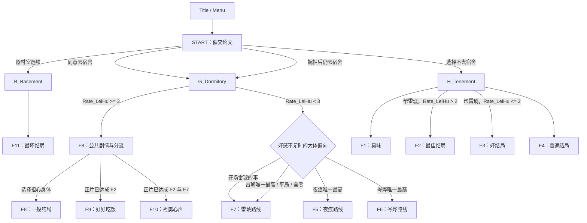
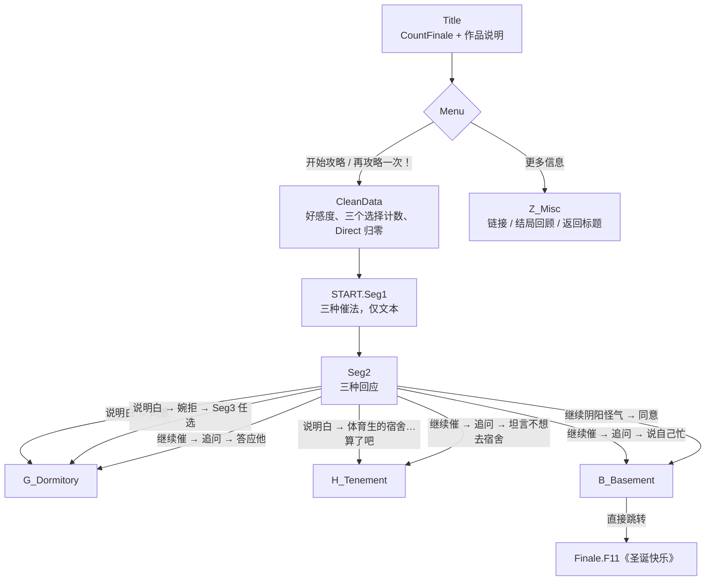
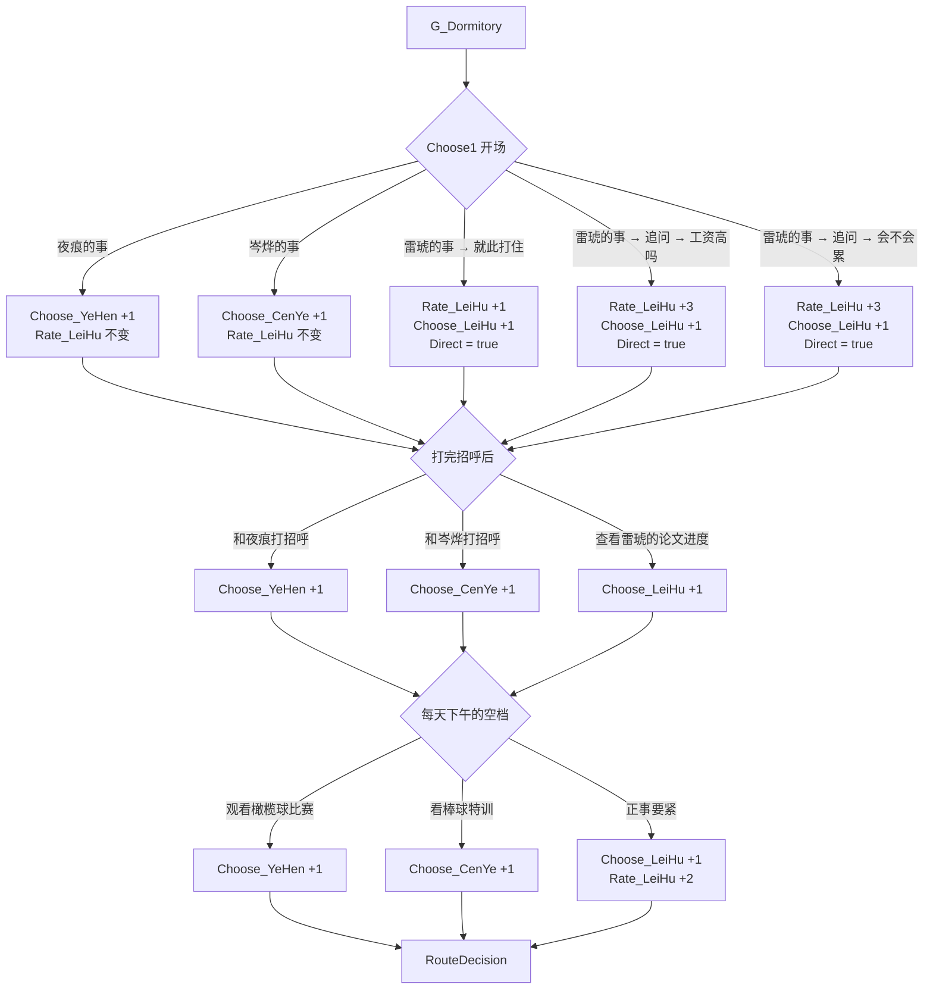
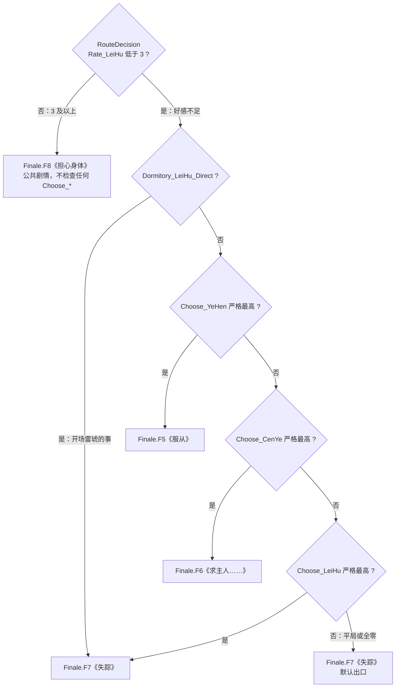
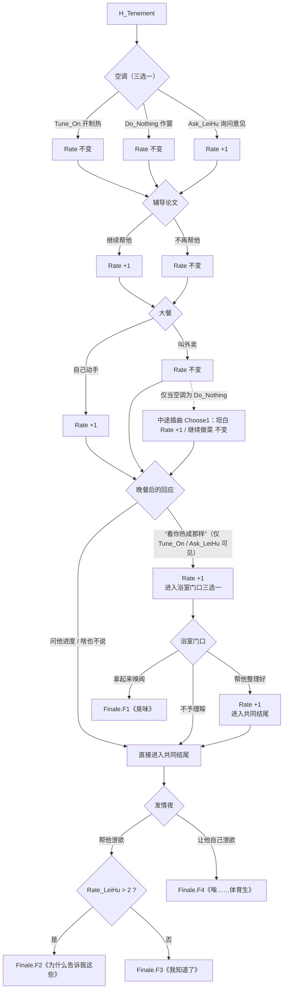
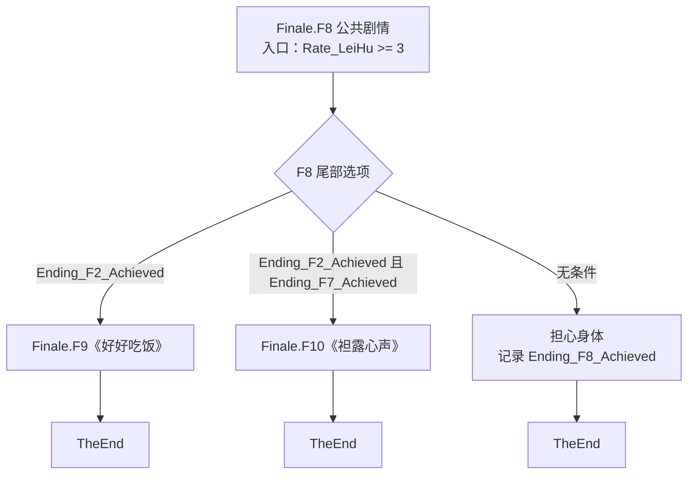

# 故事线与结局目录

> 依据源码与 2026-10-29 自动回归整理。作者已确认按 `__Docs/__RAW.txt`（RAW 原稿）的“好感度 + 大体偏向”分流，取代上一轮临时的资格判断；A-02 至 A-07 不变，剧情正文与选项未改。两套编译器各 19/19 通过，正常 F7 与 F10 可达。

## 1. 文件职责

入口文件 [`圣诞大攻略：雷琥.ink`](../圣诞大攻略：雷琥.ink) 按顺序 INCLUDE：

| 文件 | 职责 |
|---|---|
| [`0_Main.ink`](../0_Main.ink) | 标题、开始入口、初始对话与主要场景选择 |
| [`B_Basement.ink`](../B_Basement.ink) | 器材室入口；目前直接跳转到 F11 |
| [`G_Dormitory.ink`](../G_Dormitory.ink) | 宿舍日常、夜痕/岑烨/雷琥选择计数、宿舍线结局判定 |
| [`H_Tenement.ink`](../H_Tenement.ink) | 出租屋日常、空调与饮食选择、雷琥好感度及 F1–F4 分流 |
| [`Z_VAR.ink`](../Z_VAR.ink) | 变量声明、周目重置、结局统计、结局回顾与开发者菜单 |
| [`Z_Finale.ink`](../Z_Finale.ink) | F1–F11 的结局正文，以及 F8 到 F9/F10 的隐藏分支 |
| [`Z_End.ink`](../Z_End.ink) | 统一的结局后界面和返回标题入口 |
| [`Z_Misc.ink`](../Z_Misc.ink) | 更多信息、结局回顾和返回标题 |

## 2. 主线结构

宿舍线的分流点 `RouteDecision` 按 RAW 分两步判断：先看好感度是否达标（`Rate_LeiHu >= 3` 直接进 F8），再在好感不足时看开场选择与三个选择计数。上一轮“选择过即具备资格 + 夜痕 → 岑烨 → 雷琥固定优先级”的方案已被取代；该方案曾使 45 条正常路径中 F7 为 0，现已恢复可达（详见 2.3／2.4）。

上图只画主要去向；以下 2.1–2.6 按当前源码展开到选项级，供作者核对叙事与数值是否符合本意。

### 2.1 入口：标题 → START → 宿舍 / 出租屋 / 器材室

`Menu` 的两个攻略入口是同一段 `CleanData -> START` 的两种文案（`START == 0` 显示“开始攻略”，否则显示“再攻略一次！”）。`CleanData` 把 `Rate_LeiHu`、三个 `Choose_*` 与 `Dormitory_LeiHu_Direct` 归零，并清除 `IsPreviewMode`。`START.Seg1` 的三种催论文方式（旁敲侧击 / 直言不讳 / 阴阳怪气）只改变文本，不改任何变量，三条都汇合到 `Seg2`；真正决定去向的是 `Seg2` 的回应。

| `Seg2` 一级回应 | 二级选择 | 去向 |
|---|---|---|
| 说明白 | 同意 | `G_Dormitory` |
| 说明白 | 婉拒 → `Seg3`（时间宝贵 / 透露不喜欢宿舍） | `G_Dormitory` |
| 说明白 | 体育生的宿舍…算了吧 | `Seg4` → `H_Tenement` |
| 继续催 | 同意 | `G_Dormitory` |
| 继续催 | 婉拒 → `Seg3` | `G_Dormitory` |
| 继续催 | “你刚才说收拾…” → 答应他 | `G_Dormitory` |
| 继续催 | 同上 → 坦言不想去宿舍 | `Seg4` → `H_Tenement` |
| 继续催 | 同上 → 说自己忙 | `B_Basement` → `F11` |
| 继续阴阳怪气 | 同意 | `B_Basement` → `F11` |

`B_Basement` 没有额外条件，正文只有一行 `-> Finale.F11`：器材室不是独立剧情节点，而是 F11 的直达跳板。`Finale.F11` 在非预览模式记录 `Ending_F11_Achieved`，随后 `-> TheEnd`。另需注意，`Seg3` 的两个选项都回到 `G_Dormitory`，所以“婉拒”不会把玩家送去出租屋；去出租屋只有 `Seg4` 一条路。

### 2.2 宿舍线：三段选择与变量变化

`G_Dormitory.Choose1` 是开场，随后夜痕与岑烨回宿舍，再进入每天下午的空档。三段都只累加数值，不即时分流；唯一的分流点是三段之后的 `RouteDecision`。

| `Choose1` 开场 | 二级选择 | `Rate_LeiHu` | `Choose_YeHen` | `Choose_CenYe` | `Choose_LeiHu` | `Dormitory_LeiHu_Direct` |
|---|---|---|---|---|---|---|
| 夜痕的事 | — | 0 | +1 | 0 | 0 | 不变（通常为 false） |
| 岑烨的事 | — | 0 | 0 | +1 | 0 | 不变 |
| 雷琥的事 | 就此打住 | +1 | 0 | 0 | +1 | true |
| 雷琥的事 | 追问 → 工资高吗 | +3 | 0 | 0 | +1 | true |
| 雷琥的事 | 追问 → 会不会累 | +3 | 0 | 0 | +1 | true |

| 阶段 | 选项 | 变量变化 |
|---|---|---|
| 打招呼 | 和夜痕打招呼 | `Choose_YeHen` +1 |
| 打招呼 | 和岑烨打招呼 | `Choose_CenYe` +1 |
| 打招呼 | 查看雷琥的论文进度 | `Choose_LeiHu` +1 |
| 午后 | 观看橄榄球比赛 | `Choose_YeHen` +1 |
| 午后 | 看棒球特训 | `Choose_CenYe` +1 |
| 午后 | 正事要紧 | `Choose_LeiHu` +1，`Rate_LeiHu` +2 |

与 RAW 对照：RAW 在开场标注“A（好感不变，偏向夜痕）”“B（好感不变，偏向岑烨）”“C（好感增加，直接导向雷琥线结局）”，所以三段的变量语义分别是“记夜痕一笔”“记岑烨一笔”“加好感并直接锁雷琥线”。追问后的两个三级分支“是啥样的活，工资高吗？”与“会不会累？”在 RAW 352-359 都写“好感提升”，因此各加 1 点好感；这两条分支的好感合计都是 3，只是走法不同。`Dormitory_LeiHu_Direct` 只表达 RAW 的“直接导向”，是当前周目状态，不是结局记录，也不跨普通周目保留。

作者核对时值得注意：好感与三个人物计数是两套独立状态。“夜痕的事”只记 `Choose_YeHen`，“岑烨的事”只记 `Choose_CenYe`，“雷琥的事”同时加好感、记 `Choose_LeiHu` 并置 Direct。

### 2.3 好感 2/3 分界与路线分流

- 分界是 `Rate_LeiHu < 3`：2 分仍进入角色分流，3 分直接进 F8。出租屋线的 F2 用 `Rate_LeiHu > 2`，两条线都在 3 处分界，只是写法不同。
- 好感不足时先看 `Dormitory_LeiHu_Direct`：RAW 明确写“雷琥的事”是“直接导向雷琥线结局”，所以这个开场在低好感时跳过计数比较。
- 其余情况按“大体偏向”比较三个计数，且必须是**严格最高**：`Choose_YeHen > Choose_CenYe && Choose_YeHen > Choose_LeiHu` 才进 F5，岑烨、雷琥同理，每一项都写出两个明确比较，不使用 `Choose_X > (Choose_Y || Choose_Z)` 之类的隐式布尔表达式。
- 平局（两方或三方并列最高）与全零都落到末尾无条件的 `-> Finale.F7`。因此 F7 既是“雷琥唯一最高”的显式出口，也是并列与全零的默认出口。
- 注入矩阵覆盖 `Rate_LeiHu` 为 2/3 × 三个计数 8 种组合 × `Dormitory_LeiHu_Direct` 真/假，共 32 组；其中包含 `Rate_LeiHu = 3` 且 Direct 为真时仍进 F8 的组合。

### 2.4 45 条正常宿舍路径：分布

正常游玩中，宿舍线是 5 类开场 × 3 种打招呼 × 3 种午后活动 = 45 条。打招呼不影响好感，所以每个开场类的 9 条路径只有两种好感值，由午后活动决定。

| 开场类（含二级） | 开场后 `Rate_LeiHu` | 午后 0/1（+0） | 午后 2（+2） | 开场 `Choose` 增量 | Direct |
|---|---|---|---|---|---|
| 夜痕的事 | 0 | 0 | 2 | `Choose_YeHen` +1 | 否 |
| 岑烨的事 | 0 | 0 | 2 | `Choose_CenYe` +1 | 否 |
| 雷琥的事 → 就此打住 | 1 | 1 | 3 | `Choose_LeiHu` +1 | 是 |
| 雷琥的事 → 追问 → 工资高吗 | 3 | 3 | 5 | `Choose_LeiHu` +1 | 是 |
| 雷琥的事 → 追问 → 会不会累 | 3 | 3 | 5 | `Choose_LeiHu` +1 | 是 |

| 结果 | 路径数 | 占比 | 条件 |
|---|---|---|---|
| F5 | 6 | 6/45 | 好感不足、非 Direct、`Choose_YeHen` 严格最高 |
| F6 | 6 | 6/45 | 好感不足、非 Direct、`Choose_CenYe` 严格最高 |
| F7 | 12 | 12/45 | 好感不足，且（Direct 为真，或 `Choose_LeiHu` 严格最高，或平局/全零） |
| F8 | 21 | 21/45 | `Rate_LeiHu >= 3` |
| 合计 | 45 | 45/45 | 5 × 3 × 3 |

按开场类拆开：

| 开场类 | 低好感路径 | F5 | F6 | F7 | F8 |
|---|---|---|---|---|---|
| 夜痕的事 | 9 | 5 | 1 | 3 | 0 |
| 岑烨的事 | 9 | 1 | 5 | 3 | 0 |
| 雷琥的事 → 就此打住 | 6 | 0 | 0 | 6 | 3 |
| 雷琥的事 → 追问 → 工资高吗 | 0 | 0 | 0 | 0 | 9 |
| 雷琥的事 → 追问 → 会不会累 | 0 | 0 | 0 | 0 | 9 |
| 合计 | 24 | 6 | 6 | 12 | 21 |

推导要点：

1. 只有开场为“夜痕的事”或“岑烨的事”时才可能进入 F5／F6：一旦开场是“雷琥的事”，`Dormitory_LeiHu_Direct` 为真，好感不足时直接进 F7。不过“就此打住”只有 1 分，只有它的午后选择 0/1 才停留在低好感；“追问”两条分支开局就是 3 分，无论午后怎么选都进 F8。
2. 在这两个开场类里，开场自身给对应角色 1 票，打招呼与午后活动再各投 1 票。夜痕开场只要两票中至少一票给夜痕（另一票给岑烨或雷琥都行），夜痕就以 2 票严格最高，共 5 条进 F5；两票都给岑烨时岑烨 2 票进 F6；两票都给雷琥、或一票岑烨一票雷琥时形成平局，落到 F7。岑烨开场完全对称：至少一票给岑烨进 F6（5 条），两票都给夜痕进 F5（1 条），其余进 F7（3 条）。
3. F8 只由好感决定：雷琥追问工资的 9 条（开场即 3 分）、雷琥追问会不会累的 9 条（开场即 3 分）、雷琥打住后在午后选“正事要紧”的 3 条（1+2），共 21 条。
4. 因此低好感 24 条里 F5 = 6、F6 = 6、F7 = 12；高好感 21 条全部进 F8。
5. 三者全零（`Y=C=L=0`）在正常游玩中仍不存在：打招呼必须三选一，必定让某个计数 +1，所以全零只能靠注入变量构造。
6. 低好感下也不会出现“只有雷琥计数”的状态（`Y=C=0`）：若要求夜痕与岑烨都为 0，开场就不能是会增加 `Choose_YeHen` 或 `Choose_CenYe` 的“夜痕的事”“岑烨的事”，只能是基础好感至少 1 的“雷琥的事”开场；在此限制下，打招呼与午后活动又都必须选雷琥，而午后的“正事要紧”再加 2 点好感，好感因此至少为 3，进入 F8 而非低好感分支。

自动回归实测的低好感 `(Choose_YeHen, Choose_CenYe, Choose_LeiHu)` 状态共 9 种：`0,1,2`、`0,2,1`、`0,3,0`、`1,0,2`、`1,1,1`、`1,2,0`、`2,0,1`、`2,1,0`、`3,0,0`。其中 `1,1,1` 这类三方并列、以及 `0,3,0` 这类单角色满票都在正常路径中出现。

### 2.5 出租屋线：F1–F4

出租屋只能从 `Seg4` 进入，即“说明白 → 体育生的宿舍…算了吧”或“继续催 → 追问 → 坦言不想去宿舍”。

| 加分点 | 触发条件 | 增量 |
|---|---|---|
| 空调 | 询问雷琥意见（`Ask_LeiHu`） | +1 |
| 辅导 | 继续帮他 | +1 |
| 大餐 | 自己动手 | +1 |
| 晚餐 | 叫外卖，且空调为 `Do_Nothing`，中途选“坦白” | +1 |
| 晚餐后 | 选择“看你热成那样”（仅 `Tune_On` / `Ask_LeiHu` 时可见） | +1 |
| 浴室门口 | 帮他整理好叠在门口 | +1 |

- 正常游玩中，F1 只由“拿起来嗅闻”进入，与 `Rate_LeiHu` 无关。
- F2 与 F3 的分界仍是 `Rate_LeiHu > 2`，即 3 分及以上为 F2，2 分及以下为 F3。
- `自己动手` 与 `帮他整理好叠在门口` 是 2026-10-29 按 RAW 补回的加分：RAW 分别标注“A 增加好感”。`看你热成那样` 保持 +1、午后 `正事要紧` 保持 +2，因为 RAW 只写“大幅增加”“大幅度增加”，没有给出精确增量，不另行发明。
- 补回两处加分后，F3 不再能靠“堆满其它加分”进入：例如 `Ask_LeiHu` + 继续帮他 + 自己动手 + 看你热成那样 + 帮他整理 = 5 分，会进入 F2。想走 F3 需要主动避开加分，常见做法是“叫外卖 + 少量加分”（如 `Tune_On` + 不再帮他 + 叫外卖 + 看你热成那样 + 帮他整理 = 2 分），或干脆选“问他进度 / 啥也不说”跳过浴室加分。自动回归的 F3 正常路径即采用前者。
- F4 由“让他自己泄欲”直接进入，不检查好感。

### 2.6 F8 → F9 / F10 / 担心身体

`Finale.F8` 既是公共剧情也是分流节点，正常入口只有 `RouteDecision` 的 `Rate_LeiHu >= 3`，不检查任何 `Choose_*`。三个去向的条件与记账如下：

| 去向 | 显示条件 | 结束时记录（非预览） |
|---|---|---|
| 好好吃饭 | `Ending_F2_Achieved` | `Ending_F9_Achieved` |
| 袒露心声 | `Ending_F2_Achieved && Ending_F7_Achieved` | `Ending_F10_Achieved` |
| 担心身体 | 无 | `Ending_F8_Achieved` |

进入 F8 本身不记录 F8；走 F9 或 F10 也不记录 F8。达成标记跨普通新周目保留，因此 F9/F10 的条件可以跨周目累积；开发者预览与结局回顾只设 `IsPreviewMode`，不写任何达成标记，具体隔离规则见第 5 节。

| 结局 | 当前正常游玩可达 | 依据 / 入口 |
|---|---|---|
| F1–F4 | 是 | 出租屋线；`home()` 的正常路径测试通过 |
| F5 | 是 | 6/45，好感不足且 `Choose_YeHen` 严格最高 |
| F6 | 是 | 6/45，好感不足且 `Choose_CenYe` 严格最高 |
| F7 | 是 | 12/45，Direct 开场、`Choose_LeiHu` 严格最高、平局与全零共用 F7 |
| F8 | 是 | 21/45；`Rate_LeiHu >= 3` |
| F9 | 是 | 先达成 F2，本局以高好感进 F8；正常 `[2, 9]` 通过 |
| F10 | 是 | 正常 `F2 → F7 → F10` 多周目链路不注入变量即可通过 |
| F11 | 是 | 器材室入口直达 |

当前回归结论（2026-10-29 本机实测）：

- 两套编译器（native 1.2.1 与 inkjs-compatible）均编译成功；inkjs 2.2.3 在两套产物上均为 19/19。
- 45 条正常宿舍路径分布为 F5 = 6、F6 = 6、F7 = 12、F8 = 21。
- `F2 → F7 → F10` 全程使用正常宿舍/出租屋选择，不注入任何变量；测试先实测 F7 路径，再依次取得 F2 与 F7 标记，最后在 F8 看到三个去向。

### 2.7 RAW 好感标注逐项核对

下表列出 `__RAW.txt` 中所有带好感标注的选项（含两个未标注项），对照当前 `Rate_LeiHu` 增量。括号内为 RAW 行号。

**宿舍线（G）**

| 阶段 | 选项 | RAW 标注 | 当前 `Rate_LeiHu` |
|---|---|---|---|
| 开场 | 夜痕的事 | 好感不变（324） | 0；另 `Choose_YeHen` +1 |
| 开场 | 岑烨的事 | 好感不变（329） | 0；另 `Choose_CenYe` +1 |
| 开场 | 雷琥的事 | 好感增加（334） | +1；另 `Choose_LeiHu` +1、Direct |
| 追问 | 追问 | 好感增加（344） | +1 |
| 三级 | 是啥样的活，工资高吗？ | 好感提升（352） | +1 |
| 三级 | 会不会累？ | 好感提升（357） | +1（本轮补漏） |
| 招呼 | 和夜痕打招呼 | 好感不变（368） | 0 |
| 招呼 | 和岑烨打招呼 | 好感不变（375） | 0 |
| 招呼 | 查看雷琥的论文进度 | 好感不变（382） | 0 |
| 午后 | 观看橄榄球比赛 | 好感不变（395） | 0 |
| 午后 | 看棒球特训 | 好感不变（400） | 0 |
| 午后 | 正事要紧 | 好感大幅度增加（405） | +2（定性标注，沿用现值） |

**出租屋线（H）**

| 阶段 | 选项 | RAW 标注 | 当前 `Rate_LeiHu` |
|---|---|---|---|
| 空调 | 继续开制热 | 好感波动（79） | 0（定性标注，沿用现值） |
| 空调 | 就此作罢 | 未标注 | 0 |
| 空调 | 询问雷琥意见 | 好感增加（86） | +1 |
| 辅导 | 继续帮他 | 好感增加（106） | +1 |
| 辅导 | 不再帮他 | 好感不变（108） | 0 |
| 大餐 | 自己动手 | 增加好感（121） | +1 |
| 大餐 | 叫外卖 | 好感波动（134） | 0（定性标注，沿用现值） |
| 插曲（仅“就此作罢 + 叫外卖”） | 坦白 | 增加好感（151） | +1 |
| 插曲 | 继续做菜 | 不变（156） | 0 |
| 晚餐后 | 看你热成那样 | 大幅增加好感（168） | +1（定性标注，沿用现值） |
| 晚餐后 | 问他进度 | 不变（215） | 0 |
| 晚餐后 | 啥也不说 | 不变（215） | 0 |
| 浴室门口 | 帮他整理好叠在门口 | 增加好感（175） | +1 |
| 浴室门口 | 拿起来嗅闻 | 未标注（解锁臭味普通结局） | 0 |
| 浴室门口 | 不予理睬 | 不变（177） | 0 |

- **定性标注**：“好感波动”“大幅增加”“大幅度增加”在 RAW 中没有给出精确增量，表中的 0／+1／+2 是沿用现有实现的数值，**不是从 RAW 推出的精确值**；作者若要调整，只需改这几处，不影响其它明确写“增加／提升”的 +1。
- **本轮补漏**：“会不会累？”——RAW 357 写“选择B后（好感提升）”，此前只给“工资高吗？”加了好感；现在两条三级分支都 +1，基础好感同为 3。
- **未标注项**：“就此作罢”与“拿起来嗅闻”在 RAW 中没有好感标注，保持 0；后者在 RAW 176 只写“解锁臭味普通结局”。

## 3. 主要状态变量

当前变量定义见 [`Z_VAR.ink`](../Z_VAR.ink)。

| 变量 | 用途 | 当前状态 |
|---|---|---|
| `Rate_LeiHu` | 雷琥好感度/亲近程度 | 当前周目变量，由 `CleanData` 重置 |
| `Choose_YeHen` | 夜痕选择计数 | 当前周目变量，由 `CleanData` 重置 |
| `Choose_CenYe` | 岑烨选择计数 | 当前周目变量，由 `CleanData` 重置 |
| `Choose_LeiHu` | 雷琥选择计数 | 当前周目变量，由 `CleanData` 重置 |
| `Dormitory_LeiHu_Direct` | 本局开场是否选择“雷琥的事”（RAW：直接导向雷琥线结局） | 当前周目布尔变量，由 `CleanData` 重置为 `false`；不是正式结局记录 |
| `FinaleCount` | 正式达成的不同结局数量 | 统计正式达成标记；2048 种组合自动回归通过 |
| `Ending_F1_Achieved`–`Ending_F11_Achieved` | 正片实际达成的不同结局 | 普通新周目保留，结局回顾/开发者预览不设置；自动回归通过 |
| `IsPreviewMode` | 是否处于结局回顾或开发者预览模式 | 防止预览影响正式结局记录；自动回归通过 |

当前 `CleanData` 会将好感度、三个人物选择计数与 `Dormitory_LeiHu_Direct` 重置，并清除临时预览模式；它不会重置正式结局达成标记。`CountFinale` 统计这些达成标记。inkjs `ResetState` 的全量重置已通过，实际宿主 RESTART 按钮仍需验证。

## 4. F1–F11 目录

| Knot | 回顾菜单标题 | 主要入口/条件 | 维护备注 |
|---|---|---|---|
| `Finale.F1` | 普通结局《臭味》 | 出租屋线选择嗅闻衣物 | 正片完成时记录达成 |
| `Finale.F2` | 最佳结局《为什么告诉我这些》 | 出租屋线选择帮助雷琥，且 `Rate_LeiHu > 2` | 作为 F9/F10 的正片解锁条件 |
| `Finale.F3` | 好结局《我知道了》 | 帮助雷琥，但 `Rate_LeiHu <= 2` | 正片完成时记录达成 |
| `Finale.F4` | 普通结局《唉……体育生》 | 出租屋线选择让雷琥自己处理 | 正片完成时记录达成 |
| `Finale.F5` | 普通结局《服从》 | 宿舍线好感不足、非 Direct、`Choose_YeHen` 严格最高 | 重复选项是有意叙事设计，保留 |
| `Finale.F6` | 普通结局《求主人……》 | 宿舍线好感不足、非 Direct、`Choose_CenYe` 严格最高 | 汇合选项是有意叙事设计，保留 |
| `Finale.F7` | 坏结局《失踪》 | 宿舍线好感不足：Direct 开场、`Choose_LeiHu` 严格最高，或平局/全零默认 | 正常路径 12/45 |
| `Finale.F8` | 一般结局《担心身体》 | 宿舍线 `Rate_LeiHu >= 3`；同时承载公共剧情与分流 | 正常路径 21/45；仅选择并完成此结局时才记录 F8 |
| `Finale.F9` | 好结局《好好吃饭》 | F8 中正片已达成 F2 后可进入 | 正式达成标记解锁；正常路线自动回归通过 |
| `Finale.F10` | 真正结局《袒露心声》 | F8 中正片已达成 F2 与 F7 后可进入 | 正常 `F2 → F7 → F10` 链路通过 |
| `Finale.F11` | 最坏结局《圣诞快乐》 | `B_Basement` 直接跳转 | 正片完成时记录达成 |

## 5. 多周目、回顾与开发者菜单

- **正式结局回顾**：只列出通过正片实际达成的结局，而不是仅仅访问过对应 Knot；自动回归通过。
- **开发者菜单**：保留连续点击解锁入口与 `All_Finale` 全部结局预览；预览不写入正式记录，自动回归通过。
- **F8**：只有选择“担心身体”并走完该结局才算 F8 达成；进入 F9/F10 不会记录 F8，自动回归通过。
- **F9/F10**：使用正式达成条件，开发者预览 F2/F7 不影响正片隐藏路线；正常 F7 恢复可达后，F10 的正常链路已通过。
- **普通新周目**：重置好感度、三个人物选择计数与 `Dormitory_LeiHu_Direct`，但保留正式结局达成记录；自动回归通过。
- **RESTART**：inkjs `ResetState` 全量重置通过；实际宿主按钮与作品提示的一致性仍需验证。

## 6. 历史记录

- 2026-10-28：宿舍线曾改为“选择过即具备资格”（`Choose_X > 0`），多人同时被选择时按夜痕 → 岑烨 → 雷琥顺序分流。该方案使 45 条正常路径中 F7 为 0（F5=21、F6=6、F8=18），正片 F10 无法验证，两套回归停在 18/19。2026-10-29 作者确认按 RAW 原稿执行后，该方案作废。

实施步骤与验收标准见 [重构方案](REFACTOR_PLAN.md)。
