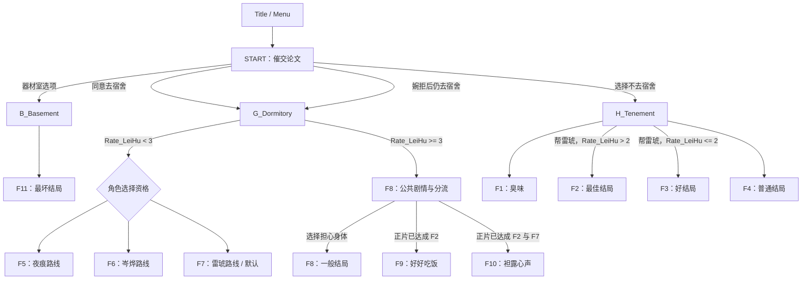
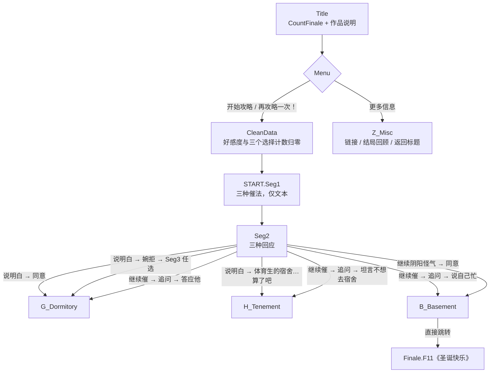
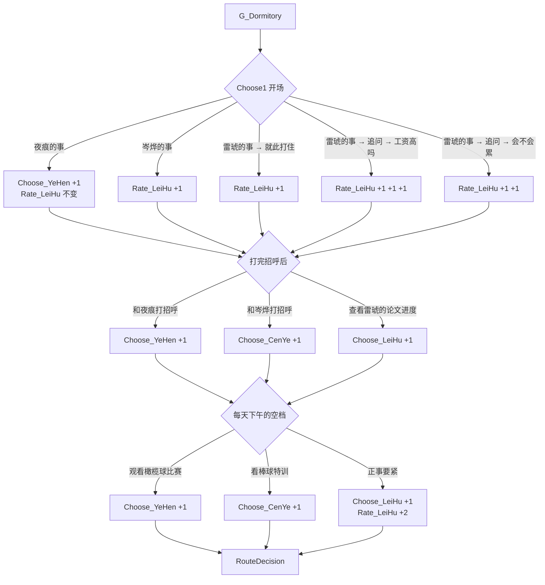
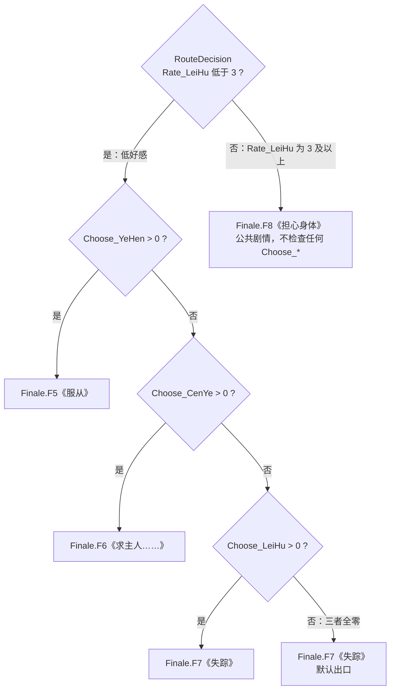
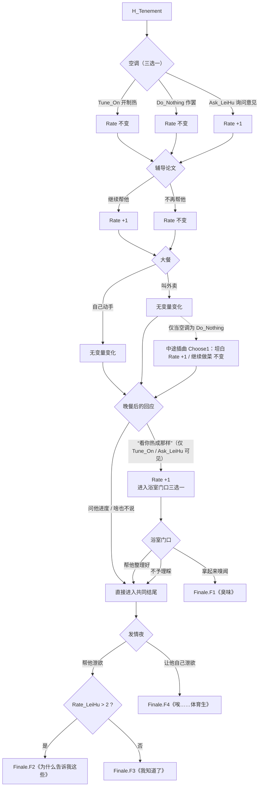
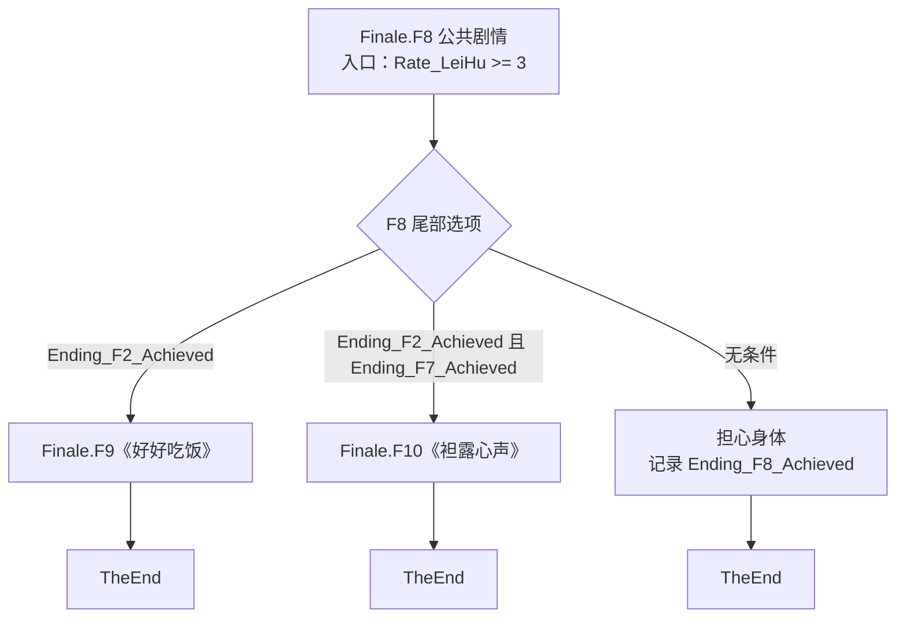

# 故事线与结局目录

> 依据源码与 2026-10-28 自动回归整理。A-01 显式选择资格已实施，结局达成与预览隔离已通过 inkjs 自动回归；但多角色优先级尚未获作者确认，当前候选顺序使正常流程 F7/F10 不可达，本分支不可合并。

## 1. 文件职责

入口文件 [`圣诞大攻略：雷琥.ink`](../圣诞大攻略：雷琥.ink) 按顺序 INCLUDE：

| 文件 | 职责 |
|---|---|
| [`0_Main.ink`](../0_Main.ink) | 标题、开始入口、初始对话与主要场景选择 |
| [`B_Basement.ink`](../B_Basement.ink) | 器材室入口；目前直接跳转到 F11 |
| [`G_Dormitory.ink`](../G_Dormitory.ink) | 宿舍日常、夜痕/岑烨/雷琥选择计数、宿舍线结局判定 |
| [`H_Tenement.ink`](../H_Tenement.ink) | 出租屋日常、空调与饮食选择、雷琥好感度及 F1–F4 分流 |
| [`Z_VAR.ink`](../Z_VAR.ink) | 变量声明、周目重置、结局统计、结局回顾与开发者菜单 |
| [`Z_Finale.ink`](../Z_Finale.ink) | F1–F11 的结局正文，以及 F8 到 F9/F10 的隐藏分支 |
| [`Z_End.ink`](../Z_End.ink) | 统一的结局后界面和返回标题入口 |
| [`Z_Misc.ink`](../Z_Misc.ink) | 更多信息、结局回顾和返回标题 |

## 2. 主线结构

宿舍线已在 `RouteDecision` 将资格改为明确的 `Choose_X > 0`，不再比较计数。多角色同时被选择时暂沿用夜痕 → 岑烨 → 雷琥的候选顺序，但作者尚未确认。自动枚举显示该候选顺序使 45 条正常宿舍路径只到达 F5/F6/F8，F7 与后续 F10 的正常可达性因此成为合并阻塞；参见 [重构方案](REFACTOR_PLAN.md)。

上图只画主要去向；以下 2.1–2.6 按当前源码展开到选项级，供作者核对叙事与数值是否符合本意。

### 2.1 入口：标题 → START → 宿舍 / 出租屋 / 器材室

`Menu` 的两个攻略入口是同一段 `CleanData -> START` 的两种文案（`START == 0` 显示“开始攻略”，否则显示“再攻略一次！”）。`CleanData` 把 `Rate_LeiHu` 与三个 `Choose_*` 归零，并清除 `IsPreviewMode`。`START.Seg1` 的三种催论文方式（旁敲侧击 / 直言不讳 / 阴阳怪气）只改变文本，不改任何变量，三条都汇合到 `Seg2`；真正决定去向的是 `Seg2` 的回应。

| `Seg2` 一级回应 | 二级选择 | 去向 |
|---|---|---|
| 说明白 | 同意 | `G_Dormitory` |
| 说明白 | 婉拒 → `Seg3`（时间宝贵 / 透露不喜欢宿舍） | `G_Dormitory` |
| 说明白 | 体育生的宿舍…算了吧 | `Seg4` → `H_Tenement` |
| 继续催 | 同意 | `G_Dormitory` |
| 继续催 | 婉拒 → `Seg3` | `G_Dormitory` |
| 继续催 | “你刚才说收拾…” → 答应他 | `G_Dormitory` |
| 继续催 | 同上 → 坦言不想去宿舍 | `Seg4` → `H_Tenement` |
| 继续催 | 同上 → 说自己忙 | `B_Basement` → `F11` |
| 继续阴阳怪气 | 同意 | `B_Basement` → `F11` |

`B_Basement` 没有额外条件，正文只有一行 `-> Finale.F11`：器材室不是独立剧情节点，而是 F11 的直达跳板。`Finale.F11` 在非预览模式记录 `Ending_F11_Achieved`，随后 `-> TheEnd`。另需注意，`Seg3` 的两个选项都回到 `G_Dormitory`，所以“婉拒”不会把玩家送去出租屋；去出租屋只有 `Seg4` 一条路。

### 2.2 宿舍线：三段选择与变量变化

`G_Dormitory.Choose1` 是开场，随后夜痕与岑烨回宿舍，再进入每天下午的空档。三段都只累加数值，不即时分流；唯一的分流点是三段之后的 `RouteDecision`。

| `Choose1` 开场 | 二级选择 | `Rate_LeiHu` | `Choose_YeHen` | `Choose_CenYe` | `Choose_LeiHu` |
|---|---|---|---|---|---|
| 夜痕的事 | — | 0 | +1 | 0 | 0 |
| 岑烨的事 | — | +1 | 0 | 0 | 0 |
| 雷琥的事 | 就此打住 | +1 | 0 | 0 | 0 |
| 雷琥的事 | 追问 → 工资高吗 | +3 | 0 | 0 | 0 |
| 雷琥的事 | 追问 → 会不会累 | +2 | 0 | 0 | 0 |

| 阶段 | 选项 | 变量变化 |
|---|---|---|
| 打招呼 | 和夜痕打招呼 | `Choose_YeHen` +1 |
| 打招呼 | 和岑烨打招呼 | `Choose_CenYe` +1 |
| 打招呼 | 查看雷琥的论文进度 | `Choose_LeiHu` +1 |
| 午后 | 观看橄榄球比赛 | `Choose_YeHen` +1 |
| 午后 | 看棒球特训 | `Choose_CenYe` +1 |
| 午后 | 正事要紧 | `Choose_LeiHu` +1，`Rate_LeiHu` +2 |

作者核对时值得注意：开场“雷琥的事”只加好感，不增加 `Choose_LeiHu`；雷琥的选择计数只来自“查看雷琥的论文进度”和午后“正事要紧”。同理，“岑烨的事”加好感但不记 `Choose_CenYe`，“夜痕的事”记 `Choose_YeHen` 但不加好感。好感与三个人物计数是两套独立状态。

### 2.3 好感 2/3 分界与路线资格

- 分界是 `Rate_LeiHu < 3`：2 分仍进入角色分流，3 分直接进 F8。出租屋线的 F2 用 `Rate_LeiHu > 2`，两条线都在 3 处分界，只是写法不同。
- A-01 的已确认语义是“选择过即具备资格”：三个判断都是独立的 `Choose_X > 0`，不是取最大计数，也不是 `Choose_YeHen > Choose_CenYe` 之类的数值竞争。16 组注入矩阵（`Rate_LeiHu` 为 2/3 × 三个计数是否非零的 8 种组合）通过，验证的正是这种资格语义。
- 三个计数同时非零时，当前实现按夜痕 → 岑烨 → 雷琥的顺序命中。这只是在实现中保留现有分支顺序的候选冲突方案，作者尚未确认，不能当作既定设计；它只影响“多个资格同时成立”的情况。
- `Choose_LeiHu > 0` 与末尾无条件的 `-> Finale.F7` 是两个不同出口：前者用于“走到这里时 Y=C=0 且 L>0”的状态，后者是三者全零的兜底。

### 2.4 45 条正常宿舍路径：分布与 F7 为何不可达

正常游玩中，宿舍线是 5 类开场 × 3 种打招呼 × 3 种午后活动 = 45 条。打招呼不影响好感，所以每个开场类的 9 条路径只有两种好感值，由午后活动决定。

| 开场类（含二级） | 开场后 `Rate_LeiHu` | 午后 0/1（+0） | 午后 2（+2） |
|---|---|---|---|
| 夜痕的事 | 0 | 0 | 2 |
| 岑烨的事 | 1 | 1 | 3 |
| 雷琥的事 → 就此打住 | 1 | 1 | 3 |
| 雷琥的事 → 追问 → 工资高吗 | 3 | 3 | 5 |
| 雷琥的事 → 追问 → 会不会累 | 2 | 2 | 4 |

| 结果 | 路径数 | 占比 | 条件 |
|---|---|---|---|
| F5 | 21 | 21/45 | 低好感，`Choose_YeHen > 0` |
| F6 | 6 | 6/45 | 低好感，`Choose_YeHen = 0` 且 `Choose_CenYe > 0` |
| F7 | 0 | 0/45 | 需要低好感且夜痕、岑烨计数均为 0（只选雷琥或全零），正常路径不存在 |
| F8 | 18 | 18/45 | `Rate_LeiHu >= 3` |
| 合计 | 45 | 45/45 | 5 × 3 × 3 |

按开场类拆开，可以直接看出低好感的 27 条为什么没有 F7：

| 开场类 | 低好感路径 | F5 | F6 | F8 |
|---|---|---|---|---|
| 夜痕的事 | 9 | 9 | 0 | 0 |
| 岑烨的事 | 6 | 4 | 2 | 3 |
| 雷琥的事 → 就此打住 | 6 | 4 | 2 | 3 |
| 雷琥的事 → 追问 → 工资高吗 | 0 | 0 | 0 | 9 |
| 雷琥的事 → 追问 → 会不会累 | 6 | 4 | 2 | 3 |
| 合计 | 27 | 21 | 6 | 18 |

F7 不可达的推导：

1. 在当前的夜痕 → 岑烨 → 雷琥顺序下，F7 的 `Choose_LeiHu > 0` 只有在 `Rate_LeiHu < 3`、`Choose_YeHen = 0`、`Choose_CenYe = 0` 时才会被轮到，也就是低好感下的“只选雷琥”状态。
2. 要让 `Choose_YeHen = 0` 且 `Choose_CenYe = 0`，开场不能是夜痕，打招呼不能是夜痕或岑烨，午后不能是橄榄球或棒球。在这些限制下，打招呼与午后只剩一种组合：打招呼 = 查看雷琥的论文进度（`Choose_LeiHu` +1），午后 = 正事要紧（`Choose_LeiHu` +1，`Rate_LeiHu` +2）。
3. 在这个固定组合下，`Rate_LeiHu` = 开场基础值 + 2。夜痕开场为 2，但夜痕开场本身已经让 `Choose_YeHen` +1；岑烨、雷琥打住、雷琥追问累分别为 3、3、4，进入 F8；雷琥追问工资为 5，也进入 F8。于是低好感下没有任何 `Y=C=0` 的状态。
4. 三者全零要求每一段都不增加任何计数，但打招呼必须三选一，必定让某个计数 +1；因此全零只能靠注入变量构造。
5. 结论：低好感的 27 条路径全部至少有一个夜痕或岑烨计数，先被 F5/F6 截走；F7 的显式出口和全零默认出口都不会在正常游玩中命中。这就是“雷琥排在最后”与不可达的关系：顺序本身不改变资格语义，但决定了 F7 只能接收 `Y=C=0` 的剩余状态，而正常低好感路径里没有这种状态。

自动回归实测低好感 `(Choose_YeHen, Choose_CenYe, Choose_LeiHu)` 状态共 11 种，全部至少有一个计数非零，没有 `(0,0,*)`，也没有 `(0,0,0)`。因此粗图中的 `R → F7` 在正常游玩中是死边。

### 2.5 出租屋线：F1–F4

出租屋只能从 `Seg4` 进入，即“说明白 → 体育生的宿舍…算了吧”或“继续催 → 追问 → 坦言不想去宿舍”。

| 加分点 | 触发条件 | 增量 |
|---|---|---|
| 空调 | 询问雷琥意见（`Ask_LeiHu`） | +1 |
| 辅导 | 继续帮他 | +1 |
| 晚餐 | 叫外卖，且空调为 `Do_Nothing`，中途选“坦白” | +1 |
| 晚餐后 | 选择“看你热成那样”（仅 `Tune_On` / `Ask_LeiHu` 时可见） | +1 |

- 正常游玩中，F1 只由“拿起来嗅闻”进入，与 `Rate_LeiHu` 无关。
- F2 与 F3 的分界是 `Rate_LeiHu > 2`，即 3 分及以上为 F2，2 分及以下为 F3。
- F2 的数值组合实际上只有一种：`Ask_LeiHu`（+1）+ 继续帮他（+1）+ 晚餐后的“看你热成那样”（+1）= 3。第四项“坦白”只在 `Do_Nothing` 时出现，而 `Do_Nothing` 看不到“看你热成那样”，两者互斥；因此正常出租屋线的上限就是 3 分。
- F4 由“让他自己泄欲”直接进入，不检查好感。

### 2.6 F8 → F9 / F10 / 担心身体，以及当前可达性

`Finale.F8` 既是公共剧情也是分流节点，正常入口只有 `RouteDecision` 的 `Rate_LeiHu >= 3`，不检查任何 `Choose_*`。三个去向的条件与记账如下：

| 去向 | 显示条件 | 结束时记录（非预览） |
|---|---|---|
| 好好吃饭 | `Ending_F2_Achieved` | `Ending_F9_Achieved` |
| 袒露心声 | `Ending_F2_Achieved && Ending_F7_Achieved` | `Ending_F10_Achieved` |
| 担心身体 | 无 | `Ending_F8_Achieved` |

进入 F8 本身不记录 F8；走 F9 或 F10 也不记录 F8。达成标记跨普通新周目保留，因此 F9/F10 的条件可以跨周目累积；开发者预览与结局回顾只设 `IsPreviewMode`，不写任何达成标记，具体隔离规则见第 5 节。

| 结局 | 当前正常游玩可达 | 依据 / 阻断点 |
|---|---|---|
| F1–F4 | 是 | 出租屋线；`home()` 的正常路径测试通过 |
| F5 | 是 | 21/45，低好感且 `Choose_YeHen > 0` |
| F6 | 是 | 6/45，低好感且 `Y=0`、`Choose_CenYe > 0` |
| F7 | 否 | 0/45；低好感下不存在 `Y=C=0` 的“只选雷琥”，全零也不可能 |
| F8 | 是 | 18/45；`Rate_LeiHu >= 3` |
| F9 | 是 | 先前周目达成 F2，本局以高好感进 F8；正常 `[2, 9]` 通过 |
| F10 | 否 | 需要 F2 与 F7 的正式标记，而 F7 标记没有正常来源 |
| F11 | 是 | 器材室入口直达 |

当前回归结论（2026-10-28 本机实测）：

- 两套编译器（native 1.2.1 与 inkjs-compatible）均编译成功；inkjs 2.2.3 在两套产物上均为 18/19。
- 唯一失败是 `normal F2 then F7 unlocks F10 across retries without injecting variables`：测试遍历 45 条正常宿舍路径后找不到 F7，在 `assert.ok(f7Path)`（`__Tests/regression.cjs:349`）失败，不是断言写错。
- F10 的标记条件本身通过注入测试：`Ending_F2_Achieved` 与 `Ending_F7_Achieved` 同时为真时“袒露心声”出现，F2/F7 的四种真假组合均符合预期（`__Tests/regression.cjs:209-218`）。
- 但正常 `F2 → F7 → F10` 在第二步断链，所以 F10 仍然不可达。`Ending_F7_Achieved` 目前只能通过注入状态或直接跳转 Knot 设置；玩家可用的正常游玩与开发者预览都不会设置它。
- 因此粗图中的 `R → F7` 和 `F8 → F10` 两条边在正常游玩中都是死边。如何恢复可达性属于作者的设计决定，本文只记录现状，不提出新规则。

## 3. 主要状态变量

当前变量定义见 [`Z_VAR.ink`](../Z_VAR.ink)。

| 变量 | 用途 | 当前状态 |
|---|---|---|
| `Rate_LeiHu` | 雷琥好感度/亲近程度 | 当前周目变量，由 `CleanData` 重置 |
| `Choose_YeHen` | 夜痕选择计数 | 当前周目变量，由 `CleanData` 重置 |
| `Choose_CenYe` | 岑烨选择计数 | 当前周目变量，由 `CleanData` 重置 |
| `Choose_LeiHu` | 雷琥选择计数 | 当前周目变量，由 `CleanData` 重置 |
| `FinaleCount` | 正式达成的不同结局数量 | 统计正式达成标记；2048 种组合自动回归通过 |
| `Ending_F1_Achieved`–`Ending_F11_Achieved` | 正片实际达成的不同结局 | 普通新周目保留，结局回顾/开发者预览不设置；自动回归通过 |
| `IsPreviewMode` | 是否处于结局回顾或开发者预览模式 | 防止预览影响正式结局记录；自动回归通过 |

当前 `CleanData` 会将好感度与三个人物选择计数重置为 0，并清除临时预览模式；它不会重置正式结局达成标记。`CountFinale` 统计这些达成标记。inkjs `ResetState` 的全量重置已通过，实际宿主 RESTART 按钮仍需验证。

## 4. F1–F11 目录

| Knot | 回顾菜单标题 | 主要入口/条件 | 维护备注 |
|---|---|---|---|
| `Finale.F1` | 普通结局《臭味》 | 出租屋线选择嗅闻衣物 | 正片完成时记录达成 |
| `Finale.F2` | 最佳结局《为什么告诉我这些》 | 出租屋线选择帮助雷琥，且 `Rate_LeiHu > 2` | 作为 F9/F10 的正片解锁条件 |
| `Finale.F3` | 好结局《我知道了》 | 帮助雷琥，但 `Rate_LeiHu <= 2` | 正片完成时记录达成 |
| `Finale.F4` | 普通结局《唉……体育生》 | 出租屋线选择让雷琥自己处理 | 正片完成时记录达成 |
| `Finale.F5` | 普通结局《服从》 | 宿舍线低好感分支；选择过夜痕即可具备路线资格 | 重复选项是有意叙事设计，保留 |
| `Finale.F6` | 普通结局《求主人……》 | 宿舍线低好感分支；选择过岑烨即可具备路线资格 | 汇合选项是有意叙事设计，保留 |
| `Finale.F7` | 坏结局《失踪》 | 宿舍线低好感分支；选择过雷琥或走默认路线 | 候选优先级下正常流程不可达，待作者决定 |
| `Finale.F8` | 一般结局《担心身体》 | 宿舍线 `Rate_LeiHu >= 3`；同时承载公共剧情与分流 | 仅选择并完成此结局时才记录 F8 |
| `Finale.F9` | 好结局《好好吃饭》 | F8 中正片已达成 F2 后可进入 | 正式达成标记解锁；正常路线自动回归通过 |
| `Finale.F10` | 真正结局《袒露心声》 | F8 中正片已达成 F2 与 F7 后可进入 | 标记条件通过；正常路线受 F7 不可达阻塞 |
| `Finale.F11` | 最坏结局《圣诞快乐》 | `B_Basement` 直接跳转 | 正片完成时记录达成 |

## 5. 多周目、回顾与开发者菜单

- **正式结局回顾**：只列出通过正片实际达成的结局，而不是仅仅访问过对应 Knot；自动回归通过。
- **开发者菜单**：保留连续点击解锁入口与 `All_Finale` 全部结局预览；预览不写入正式记录，自动回归通过。
- **F8**：只有选择“担心身体”并走完该结局才算 F8 达成；进入 F9/F10 不会记录 F8，自动回归通过。
- **F9/F10**：使用正式达成条件，开发者预览 F2/F7 不影响正片隐藏路线；标记条件通过，正常 F10 受 F7 不可达阻塞。
- **普通新周目**：重置当前周目的好感度与角色选择计数，但保留正式结局达成记录；自动回归通过。
- **RESTART**：inkjs `ResetState` 全量重置通过；实际宿主按钮与作品提示的一致性仍需验证。

实施步骤、当前失败与验收标准见 [重构方案](REFACTOR_PLAN.md)。
